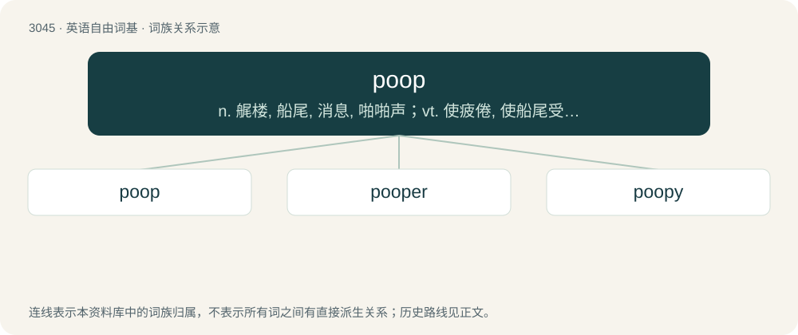

# 3145 · poop — n. 艉楼, 船尾, 消息, 啪啪声；vt. 使疲倦, 使船尾受击；vi. 疲乏, 发啪啪声

[总目录](../00_总目录_按常用程度.md)

**类型**：英语自由词基　｜　**来源语言**：见词源记录

## 核心含义与来源

- 核心含义：n. 艉楼, 船尾, 消息, 啪啪声；vt. 使疲倦, 使船尾受击；vi. 疲乏, 发啪啪声
- 英文含义：To defecate.
- 词形：poop

**多个词源／构词路径**：同一拼写可能有不同来源；以下按词性和含义分别列出。

**来源记录 1**（动词；To defecate.）

Uncertain, possibly from Middle English poupen (“to make a gulping sound while drinking, blow on a horn, toot”). Compare Dutch poepen (“to defecate”), German Low German pupen (“to fart; break wind”). Also representing poo pronounced with the mouth snapped closed at the end.

**来源记录 2**（名词；A set of data or general information, written or spoken, usually concerning machinery or a process.）

Recorded in World War II (1941) Army slang poop sheet (“up-to-date information”), itself of uncertain origin, perhaps toilet paper (referring to etymology 1).

**来源记录 3**（动词；To tire, exhaust.）

Uncertain, perhaps sound imitation.

**来源记录 4**（名词；The rear part (after end) of a ship or other vessel.）

From Middle English poupe, pope, from Old French pope, poupe, pouppe, from Italian poppa, from Vulgar Latin \*puppa, from Latin puppis, all meaning “stern of a ship”.

**来源记录 5**（名词；A stupid or ineffectual person.）

Uncertain, perhaps a shortening of nincompoop.

## 词族图

## 单词速览（常用到不常用）

| 单词 | 音标 | 释义 |
|---|---|---|
| [poop](#w-1) | /ˈpuːp/ | n. 艉楼, 船尾, 消息, 啪啪声；vt. 使疲倦, 使船尾受击；vi. 疲乏, 发啪啪声 |
| [pooper](#w-2) | /ˈpuːpə/ | 翻过船尾的大浪 |
| [poopy](#w-3) | /ˈpuːpi/ | \[网络\] 疲倦的 |

## 逐词详解

### 1. poop

**词性**：动词　｜　**音标**：/ˈpuːp/

**中文释义**：n. 艉楼, 船尾, 消息, 啪啪声；vt. 使疲倦, 使船尾受击；vi. 疲乏, 发啪啪声

**英文义项**：To defecate. / To defecate in or on something.

**词源与演化**：

Uncertain, possibly from Middle English poupen (“to make a gulping sound while drinking, blow on a horn, toot”). Compare Dutch poepen (“to defecate”), German Low German pupen (“to fart; break wind”). Also representing poo pronounced with the mouth snapped closed at the end.

**例句**：

> You'll poop yourself if you have to walk all five miles home without stopping.

该用例对应义项：To defecate on one's person.

### 2. pooper

**词性**：名词　｜　**音标**：/ˈpuːpə/

**中文释义**：翻过船尾的大浪

**英文义项**：The anus; often in reference to anal intercourse. / One who poops out on an activity; one who dampens the mood by lack of participation or negative attitude. Mostly used in the phrase party pooper.

**构词拆分**：poop + -er

**词源与演化**：

From poop + -er.

**例句**：

> Jimmy's toilet training is finally over; he's becoming a good little pooper.

该用例对应义项：One who poops; or, poops well.

### 3. poopy

**词性**：形容词　｜　**音标**：/ˈpuːpi/

**中文释义**：\[网络\] 疲倦的

**英文义项**：worthless; unpleasant / Dirty with feces.

**构词拆分**：poop + -y

**词源与演化**：

From poop + -y. Compare shitty.

**例句**：

> Can we stop the car? I'm poopy.

该用例对应义项：needing to poop (defecate)
