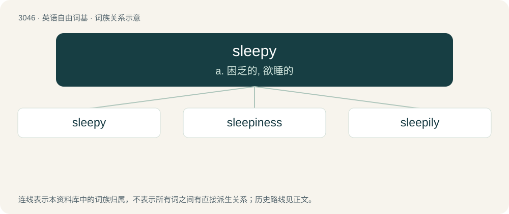

# 3146 · sleepy — a. 困乏的, 欲睡的

[总目录](../00_总目录_按常用程度.md)

**类型**：英语自由词基　｜　**来源语言**：见词源记录

## 核心含义与来源

- 核心含义：a. 困乏的, 欲睡的
- 英文含义：Tired; feeling the need for sleep.
- 词形：sleepy

**来源记录 1**（形容词；Tired; feeling the need for sleep.）

From Middle English slepy, from Old English \*slǣpiġ (attested in unslǣpiġ (“sleepless”)), from Proto-West Germanic \*slāpag (“sleepy”), equivalent to sleep + -y. Cognate with Saterland Frisian släipich (“sleepy”), West Frisian sliepich (“sleepy”), dialectal Dutch slapig, slepig (“sleepy”), German Low German slapig, släpig, slöpig (“sleepy”), archaic German schlafig (“sleepy”).

## 词族图

## 单词速览（常用到不常用）

| 单词 | 音标 | 释义 |
|---|---|---|
| [sleepy](#w-1) | /ˈsliːpi/ | a. 困乏的, 欲睡的 |
| [sleepiness](#w-2) | /ˈsliːpinis/ | n. 睡意；\[医\] 瞌睡, 欲睡 |
| [sleepily](#w-3) | /ˈsliːpili/ | adv. 想睡地, 困倦地 |

## 逐词详解

### 1. sleepy

**词性**：形容词　｜　**音标**：/ˈsliːpi/

**中文释义**：a. 困乏的, 欲睡的

**英文义项**：Tired; feeling the need for sleep. / Suggesting tiredness.

**构词拆分**：sleep + -y

**词源与演化**：

From Middle English slepy, from Old English \*slǣpiġ (attested in unslǣpiġ (“sleepless”)), from Proto-West Germanic \*slāpag (“sleepy”), equivalent to sleep + -y. Cognate with Saterland Frisian släipich (“sleepy”), West Frisian sliepich (“sleepy”), dialectal Dutch slapig, slepig (“sleepy”), German Low German slapig, släpig, slöpig (“sleepy”), archaic German schlafig (“sleepy”).

**用法示例／搭配（非完整句）**：

> a sleepy drink or potion

该用例对应义项：Tending to induce sleep.

### 2. sleepiness

**词性**：名词　｜　**音标**：/ˈsliːpinis/

**中文释义**：n. 睡意；\[医\] 瞌睡, 欲睡

**英文义项**：The property of being sleepy.

**构词拆分**：sleepy + -ness

**词源与演化**：

From sleepy + -ness.

**例句**：

> Sleepiness causes many driving accidents.

该用例对应义项：a very sleepy state

### 3. sleepily

**词性**：副词　｜　**音标**：/ˈsliːpili/

**中文释义**：adv. 想睡地, 困倦地

**英文义项**：In a sleepy manner.

**构词拆分**：sleepy + -ly

**词源与演化**：

From sleepy + -ly.

**例句**：

> The two children who were snuggled sleepily in the back of the car.

该用例对应义项：in a sleepy manner
