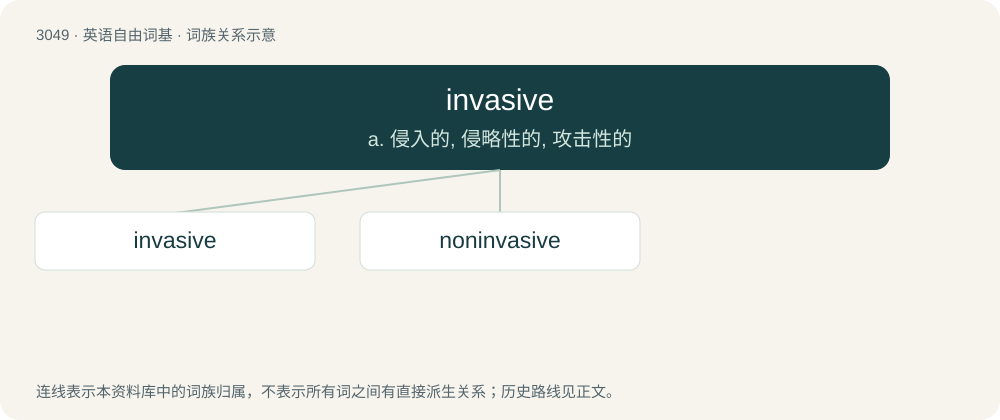

# 3148 · invasive — a. 侵入的, 侵略性的, 攻击性的

[总目录](../00_总目录_按常用程度.md)

**类型**：英语自由词基　｜　**来源语言**：见词源记录

## 核心含义与来源

- 核心含义：a. 侵入的, 侵略性的, 攻击性的
- 英文含义：Of or pertaining to invasion; offensive.
- 词形：invasive

## 词族图

## 单词速览（常用到不常用）

| 单词 | 音标 | 释义 |
|---|---|---|
| [invasive](#w-1) | 英 /ɪnˈveɪsɪv/ | a. 侵入的, 侵略性的, 攻击性的 |
| [noninvasive](#w-2) |  | a. 非侵害的, 无损伤的, 非侵袭的 |

## 逐词详解

### 1. invasive

**词性**：形容词　｜　**音标**：英 /ɪnˈveɪsɪv/

**中文释义**：a. 侵入的, 侵略性的, 攻击性的

**英文义项**：Of or pertaining to invasion; offensive. / That invades a foreign country using military force; also, militarily aggressive.

**用法示例／搭配（非完整句）**：

> an invasive species

该用例对应义项：Of an organism: that grows (especially uncontrollably) in environments which do not harbour natural enemies, often to the detriment of native species or of food or garden flora and fauna.

### 2. noninvasive

**词性**：形容词

**中文释义**：a. 非侵害的, 无损伤的, 非侵袭的

**英文义项**：Not invasive. / Of a surgical or other medical procedure, not requiring an incision.

**构词拆分**：From non- + invasive.

**词源与演化**：

From non- + invasive.

**例句**：

> Through this noninvasive type of project investigators can study some aspects of wildlife populations that previously involved intensive capture operations.
