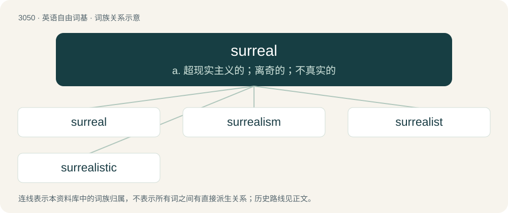

# 3149 · surreal — a. 超现实主义的；离奇的；不真实的

[总目录](../00_总目录_按常用程度.md)

**类型**：英语自由词基　｜　**来源语言**：见词源记录

## 核心含义与来源

- 核心含义：a. 超现实主义的；离奇的；不真实的
- 英文含义：Resembling a dream: fantastic and incongruous.
- 词形：surreal

**来源记录 1**（形容词；Resembling a dream: fantastic and incongruous.）

A back-formation from surrealism, equivalent to sur- + real.

## 词族图

## 单词速览（常用到不常用）

| 单词 | 音标 | 释义 |
|---|---|---|
| [surreal](#w-1) | 英 /səˈɹiː(.ə)l/ | a. 超现实主义的；离奇的；不真实的 |
| [surrealism](#w-2) | 英 /səˈɹiː(.ə)l.ɪz.əm/ | n. 超现实主义；\[法\] 超现实主义 |
| [surrealist](#w-3) | /səˈriəlist/ | n. 超现实主义者 |
| [surrealistic](#w-4) | 英 /səˌɹiː.əˈlɪs.tɪk/；美 /səˌɹi.əˈlɪs.tɪk/ | a. 超现实主义的 |

## 逐词详解

### 1. surreal

**词性**：形容词　｜　**音标**：英 /səˈɹiː(.ə)l/

**中文释义**：a. 超现实主义的；离奇的；不真实的

**英文义项**：Resembling a dream: fantastic and incongruous.

**构词拆分**：sur- + real

**词源与演化**：

A back-formation from surrealism, equivalent to sur- + real.

**例句**：

> The movie had a dreamlike, surreal atmosphere.

该用例对应义项：Resembling a dream: fantastic and incongruous.

### 2. surrealism

**词性**：名词　｜　**音标**：英 /səˈɹiː(.ə)l.ɪz.əm/

**中文释义**：n. 超现实主义；\[法\] 超现实主义

**英文义项**：An artistic movement and an aesthetic philosophy that aims for the liberation of the mind by emphasizing the critical and imaginative powers of the subconscious. / Art with a surreal aesthetic or narrative, regardless of whether or not it is linked to the surrealist movement.

**构词拆分**：surreal + -ism

**词源与演化**：

Borrowed from French surréalisme. By surface analysis, sur- + realism or surreal + -ism.

**例句**：

> Dalí is the surrealist for people who don't like surrealism.

### 3. surrealist

**词性**：形容词　｜　**音标**：/səˈriəlist/

**中文释义**：n. 超现实主义者

**英文义项**：Of, or relating to the modernist art movement surrealism; (by extension) having a similar surreal aesthetic or narrative.

**构词拆分**：surreal + -ist

**词源与演化**：

From surreal + -ist.

**例句**：

> I'd like to read surrealist writing in my target language.

### 4. surrealistic

**词性**：形容词　｜　**音标**：英 /səˌɹiː.əˈlɪs.tɪk/；美 /səˌɹi.əˈlɪs.tɪk/

**中文释义**：a. 超现实主义的

**英文义项**：surreal.

**构词拆分**：surreal + -istic

**词源与演化**：

From surreal + -istic.
