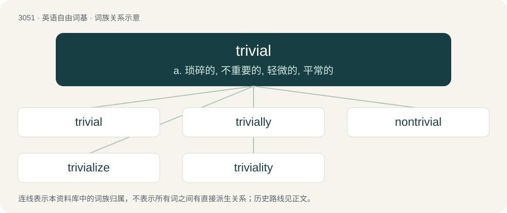

# 3150 · trivial — a. 琐碎的, 不重要的, 轻微的, 平常的

[总目录](../00_总目录_按常用程度.md)

**类型**：英语自由词基　｜　**来源语言**：见词源记录

## 核心含义与来源

- 核心含义：a. 琐碎的, 不重要的, 轻微的, 平常的
- 英文含义：Ignorable; of little significance or value.
- 词形：trivial

## 词族图

## 单词速览（常用到不常用）

| 单词 | 音标 | 释义 |
|---|---|---|
| [trivial](#w-1) | /ˈtɹɪv.i.əl/ | a. 琐碎的, 不重要的, 轻微的, 平常的 |
| [trivially](#w-2) | /ˈtrɪvɪəlɪ/ | adv. 琐细地; 很一般的; 无能地; 平凡地 |
| [nontrivial](#w-3) | 英 /ˌnɒnˈtɹɪ.vi.əl/ | 非平凡的 |
| [trivialize](#w-4) | /ˈtɹɪviəlaɪz/ | vt. 使平凡, 使琐碎 |
| [triviality](#w-5) | /ˌtɹɪviˈæləti/ | n. 琐事, 平凡, 浅薄 |

## 逐词详解

### 1. trivial

**词性**：形容词　｜　**音标**：/ˈtɹɪv.i.əl/

**中文释义**：a. 琐碎的, 不重要的, 轻微的, 平常的

**英文义项**：Ignorable; of little significance or value. / Commonplace, ordinary.

**例句**：

> Patriotism is the willingness to kill and be killed for trivial reasons.

### 2. trivially

**词性**：副词　｜　**音标**：/ˈtrɪvɪəlɪ/

**中文释义**：adv. 琐细地; 很一般的; 无能地; 平凡地

**英文义项**：In a trivial manner.

**构词拆分**：trivial + -ly

**词源与演化**：

From trivial + -ly.

### 3. nontrivial

**词性**：形容词　｜　**音标**：英 /ˌnɒnˈtɹɪ.vi.əl/

**中文释义**：非平凡的

**英文义项**：Not obvious or easy to prove; not self-evident. / Not being of the simplest kind; not being empty or a singleton.

**构词拆分**：non- + trivial

**词源与演化**：

From non- + trivial.

**用法示例／搭配（非完整句）**：

> nontrivial subgroup

该用例对应义项：Not being of the simplest kind; not being empty or a singleton.

### 4. trivialize

**词性**：动词　｜　**音标**：/ˈtɹɪviəlaɪz/

**中文释义**：vt. 使平凡, 使琐碎

**英文义项**：To make something appear trivial

**构词拆分**：trivial + -ize

**词源与演化**：

From trivial + -ize.

**例句**：

> Don't trivialize the seriousness of the issue!

该用例对应义项：make trivial or insignificant

### 5. triviality

**词性**：名词　｜　**音标**：/ˌtɹɪviˈæləti/

**中文释义**：n. 琐事, 平凡, 浅薄

**英文义项**：The quality of being trivial or unimportant. / Something which is trivial or unimportant.

**构词拆分**：trivial + -ity

**词源与演化**：

From trivial + -ity.

**例句**：

> Life is strange and changeable. A triviality is enough to kill us or lift us up.
