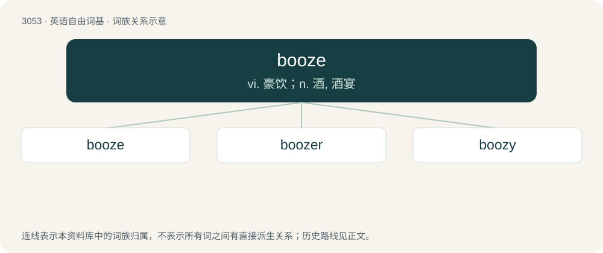

# 3151 · booze — vi. 豪饮；n. 酒, 酒宴

[总目录](../00_总目录_按常用程度.md)

**类型**：英语自由词基　｜　**来源语言**：见词源记录

## 核心含义与来源

- 核心含义：vi. 豪饮；n. 酒, 酒宴
- 英文含义：Any alcoholic beverage.
- 词形：booze

**来源记录 1**（名词；Any alcoholic beverage.）

Originally a Northern England dialectal form of bowse.

## 词族图

## 单词速览（常用到不常用）

| 单词 | 音标 | 释义 |
|---|---|---|
| [booze](#w-1) | 英 /buːz/；美 /buz/ | vi. 豪饮；n. 酒, 酒宴 |
| [boozer](#w-2) | 英 /ˈbuː.zə(ɹ)/ | n. 痛饮者 |
| [boozy](#w-3) | /ˈbuːzi/ | a. 酩酊的, 嗜酒的 |

## 逐词详解

### 1. booze

**词性**：动词　｜　**音标**：英 /buːz/；美 /buz/

**中文释义**：vi. 豪饮；n. 酒, 酒宴

**英文义项**：To drink alcohol. / To drink (an alcoholic beverage).

**词源与演化**：

Originally a Northern England dialectal form of bowse.

**例句**：

> Thomas spent close to half his salary on cigarettes and booze.

### 2. boozer

**词性**：名词　｜　**音标**：英 /ˈbuː.zə(ɹ)/

**中文释义**：n. 痛饮者

**英文义项**：One who drinks alcohol habitually; a drunkard. / A public house, pub.

**构词拆分**：booze + -er (agent noun suffix)

**词源与演化**：

From booze + -er (agent noun suffix) or (pub) + -er (relational noun suffix).

**例句**：

> It's better to be a well-known boozer than an anonymous alcoholic.

### 3. boozy

**词性**：形容词　｜　**音标**：/ˈbuːzi/

**中文释义**：a. 酩酊的, 嗜酒的

**英文义项**：Intoxicated by alcohol. / Inclined to consume a significant amount of alcohol.

**构词拆分**：booze + -y

**词源与演化**：

From booze + -y.

**例句**：

> For dessert, the hosts treated us to a helping of boozy apple pie.

该用例对应义项：Containing or cooked with alcohol.
