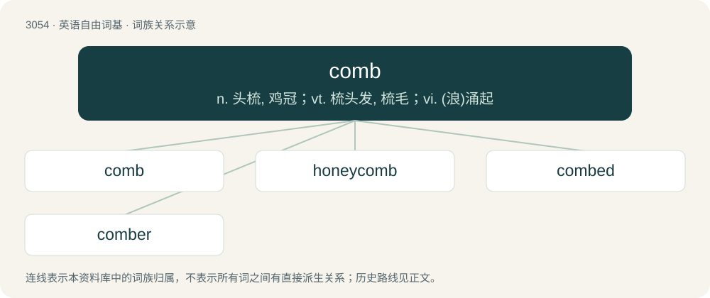

# 3152 · comb — n. 头梳, 鸡冠；vt. 梳头发, 梳毛；vi. (浪)涌起

[总目录](../00_总目录_按常用程度.md)

**类型**：英语自由词基　｜　**来源语言**：见词源记录

## 核心含义与来源

- 核心含义：n. 头梳, 鸡冠；vt. 梳头发, 梳毛；vi. (浪)涌起
- 英文含义：A toothed implement for grooming the hair or (formerly) for keeping it in place.
- 词形：comb

**来源记录 1**（名词；A toothed implement for grooming the hair or (formerly) for keeping it in place.）

From Middle English comb, from Old English camb (“comb”), from Proto-West Germanic \*kamb, from Proto-Germanic \*kambaz (“comb”), from Proto-Indo-European \*ǵómbʰos (“tooth”), a doublet of cam. The verb is derived from the noun and displaced the older verb kemb. Cognates Compare Saterland Frisian Koum, Swedish/Dutch kam, Danish kam, Norwegian kam, German Kamm; also Tocharian B keme, Lithuanian žam̃bas (“sharp edge”), Old Church Slavonic зѫбъ (zǫbŭ), Albanian dhëmb, Ancient Greek γομφίος (gomphíos, “backtooth, molar”), Sanskrit जम्भ (jambha)).

## 词族图

## 单词速览（常用到不常用）

| 单词 | 音标 | 释义 |
|---|---|---|
| [comb](#w-1) | 英 /kəʊm/；美 /koʊm/ | n. 头梳, 鸡冠；vt. 梳头发, 梳毛；vi. (浪)涌起 |
| [honeycomb](#w-2) | 英 /ˈhʌnikəʊm/；美 /ˈhʌniˌkoʊm/ | n. 蜂巢, 蜂房, 蜂窝；a. 蜂巢的；vt. 使成蜂巢状 |
| [combed](#w-3) | /kəʊmd/ | n. 精梳；v. 梳理( comb的过去式和过去分词 ); 在…搜寻, 彻底搜查 |
| [comber](#w-4) | 英 /ˈkəʊmə/；美 /ˈkoʊmɚ/ | n. 梳刷者, 精梳机, 卷浪 |

## 逐词详解

### 1. comb

**词性**：动词　｜　**音标**：英 /kəʊm/；美 /koʊm/

**中文释义**：n. 头梳, 鸡冠；vt. 梳头发, 梳毛；vi. (浪)涌起

**英文义项**：Especially of hair or fur, to groom with a toothed implement, especially a comb. / To separate choice cotton fibers from worsted cloth fibers.

**词源与演化**：

From Middle English comb, from Old English camb (“comb”), from Proto-West Germanic \*kamb, from Proto-Germanic \*kambaz (“comb”), from Proto-Indo-European \*ǵómbʰos (“tooth”), a doublet of cam. The verb is derived from the noun and displaced the older verb kemb. Cognates Compare Saterland Frisian Koum, Swedish/Dutch kam, Danish kam, Norwegian kam, German Kamm; also Tocharian B keme, Lithuanian žam̃bas (“sharp edge”), Old Church Slavonic зѫбъ (zǫbŭ), Albanian dhëmb, Ancient Greek γομφίος (gomphíos, “backtooth, molar”), Sanskrit जम्भ (jambha)).

**例句**：

> Police combed the field for evidence after the assault.

该用例对应义项：To search thoroughly as if raking over an area with a comb.

### 2. honeycomb

**词性**：名词　｜　**音标**：英 /ˈhʌnikəʊm/；美 /ˈhʌniˌkoʊm/

**中文释义**：n. 蜂巢, 蜂房, 蜂窝；a. 蜂巢的；vt. 使成蜂巢状

**英文义项**：A substance made by bees (clade Anthophila) primarily from beeswax which has hexagonal cells to hold their larvae, and for storing pollen and honey to feed the larvae and themselves when other food is scarce; it is also eaten by humans as part of comb-honey; (countable) a single sheet made up of two layers of this substance. / Something resembling honeycomb (noun sense 1) in having numerous cells or small holes.

**构词拆分**：honey + comb

**词源与演化**：

The noun is derived from Middle English honycomb, from Old English huniġcamb, from huniġ (“honey”) (ultimately from Proto-Indo-European \*kn̥h₂ónks (“honey”)) + camb (“comb”) (ultimately from Proto-Indo-European \*ǵómbʰos (“peg; tooth; row of teeth”)). The English word is analysable as honey + comb. The Oxford English Dictionary posits that the arrangement of several plates of wax “hanging parallel to each other from the roof of the hive suggests a comb with its teeth”. The verb is derived from the noun. Compare Saterland Frisian Hunichmoarte (“honeycomb”), West Frisian huningskiif (“honeycomb”), Dutch honingraat (“honeycomb”), German Honigwabe (“honeycomb”).

**例句**：

> The wood porch was a honeycomb of termite tunnels before we replaced it.

该用例对应义项：Something resembling honeycomb (noun sense 1) in having numerous cells or small holes.

### 3. combed

**词性**：形容词　｜　**音标**：/kəʊmd/

**中文释义**：n. 精梳；v. 梳理( comb的过去式和过去分词 ); 在…搜寻, 彻底搜查

**英文义项**：Arranged or groomed with a comb.

**构词拆分**：comb + -ed

**词源与演化**：

From Middle English combed, kombide, equivalent to comb + -ed.

**用法示例／搭配（非完整句）**：

> combed hair

该用例对应义项：Arranged or groomed with a comb.

### 4. comber

**词性**：名词　｜　**音标**：英 /ˈkəʊmə/；美 /ˈkoʊmɚ/

**中文释义**：n. 梳刷者, 精梳机, 卷浪

**英文义项**：A person who combs wool, etc. / A machine that combs wool, etc.

**构词拆分**：comb + -er

**词源与演化**：

From Middle English comber, camber, equivalent to comb + -er.
