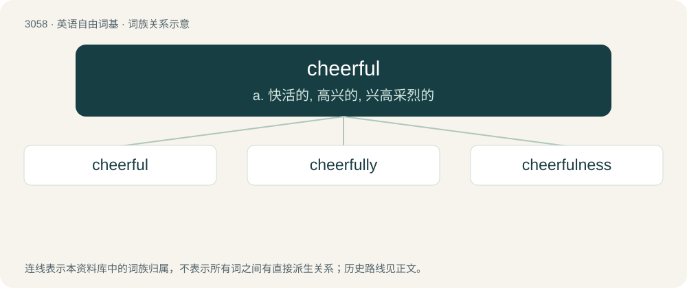

# 3154 · cheerful — a. 快活的, 高兴的, 兴高采烈的

[总目录](../00_总目录_按常用程度.md)

**类型**：英语自由词基　｜　**来源语言**：见词源记录

## 核心含义与来源

- 核心含义：a. 快活的, 高兴的, 兴高采烈的
- 英文含义：Noticeably happy and optimistic.
- 词形：cheerful

**来源记录 1**（形容词；Noticeably happy and optimistic.）

From Middle English chereful, cherful, equivalent to cheer + -ful.

## 词族图

## 单词速览（常用到不常用）

| 单词 | 音标 | 释义 |
|---|---|---|
| [cheerful](#w-1) | 英 /ˈt͡ʃɪəfl̩/；美 /ˈt͡ʃɪɹfl̩/ | a. 快活的, 高兴的, 兴高采烈的 |
| [cheerfully](#w-2) | 英 /ˈtʃɪəfəli/；美 /ˈt͡ʃɪɹfəli/ | adv. 高高兴兴地 |
| [cheerfulness](#w-3) | 英 /ˈt͡ʃɪəfəlnəs/；美 /ˈt͡ʃɪɹfəlnəs/ | n. 高兴, 快活 |

## 逐词详解

### 1. cheerful

**词性**：形容词　｜　**音标**：英 /ˈt͡ʃɪəfl̩/；美 /ˈt͡ʃɪɹfl̩/

**中文释义**：a. 快活的, 高兴的, 兴高采烈的

**英文义项**：Noticeably happy and optimistic. / Bright and pleasant.

**构词拆分**：cheer + -ful

**词源与演化**：

From Middle English chereful, cherful, equivalent to cheer + -ful.

**例句**：

> They enjoyed a cheerful room.

该用例对应义项：Bright and pleasant.

### 2. cheerfully

**词性**：副词　｜　**音标**：英 /ˈtʃɪəfəli/；美 /ˈt͡ʃɪɹfəli/

**中文释义**：adv. 高高兴兴地

**英文义项**：In a cheerful manner.

**构词拆分**：cheerful + -ly

**词源与演化**：

From Middle English cherefully; equivalent to cheerful + -ly.

**例句**：

> He cheerfully agreed to do it.

该用例对应义项：in a cheerful manner

### 3. cheerfulness

**词性**：名词　｜　**音标**：英 /ˈt͡ʃɪəfəlnəs/；美 /ˈt͡ʃɪɹfəlnəs/

**中文释义**：n. 高兴, 快活

**英文义项**：The state of being cheerful; joy.

**构词拆分**：cheerful + -ness

**词源与演化**：

From Middle English cherefulnes; equivalent to cheerful + -ness.

**例句**：

> Flowers added a note of cheerfulness to the drab room.

该用例对应义项：the quality of being cheerful and dispelling gloom
