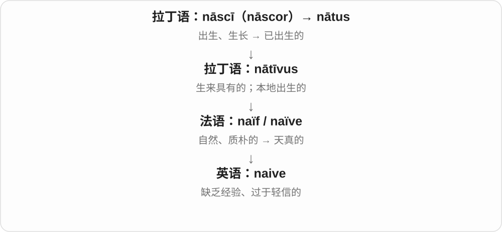
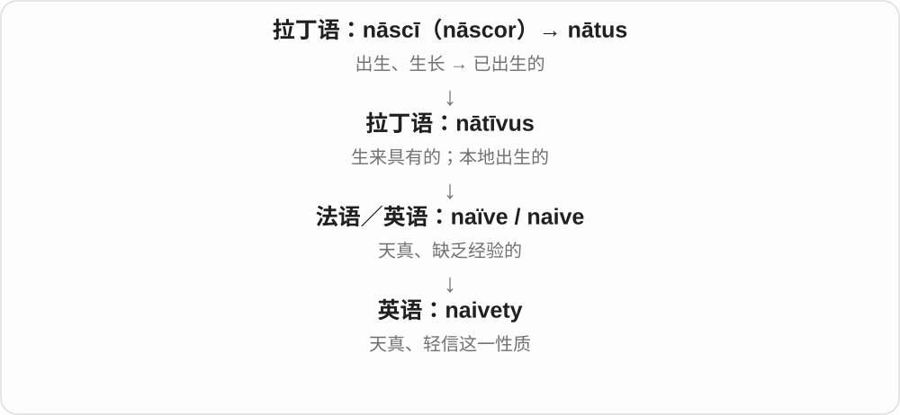

# 3154 · naive — 自然、未经世事的旧材料，发展出缺少经验的判断

[逐词精讲目录](../00_逐词精讲目录.md) · [总目录](../00_总目录_按常用程度.md)

## 核心词根与来源

先把天真与缺少经验连起来，不要只背幼稚一个贬词。语境可能轻责，也可能欣赏无心机；是否可靠要看具体判断。

**NAIVE：看得太简单，还没想到现实的曲折**

naive → naively、naivety，性质、方式和经验不足的状态。

- **性质、方式与抽象名词**：naive · naively · naivety

## 词形与演化规律

nativus → 法语 naïve → naive；-ly 副词保留 e；naivety 是相应性质名词形式。

## 单词速览（按词族由简到繁）

同一基础词的相关扩展放在一起，先读基础形式，再读扩展；各组之间优先读常用的。具体词源关系见各词讲解。

| 单词 | 音标 | 核心意思 |
|---|---|---|
| [naive](#w-1) | /naɪˈiːv/ | 天真的；缺乏经验的；过于轻信的 |
| [naively](#w-2) | /naɪˈiːvli/ | 天真地；轻信地；缺少经验地 |
| [naivety](#w-3) | /naɪˈiːvəti/ | 天真；经验不足；轻信 |

## 逐词讲解

### 1. naive — 天真的；缺乏经验的；过于轻信的

**音标**：/naɪˈiːv/

**先抓住这个画面**

naive 像刚接触复杂世界时，觉得别人说的都是真的、事情会按最简单的方式发展。

**怎么拆**

借自法语 naïve，是 naïf 的阴性形式；更早来自拉丁语 nātīvus“天生、自然的”，与 native 同源。

**怎么变成今天的意思**

未加修饰的自然样子，可以是质朴，也可能显得不谙世事。现代普通用法常带“想得太简单”的批评。

**常见搭配与例句**

naive about…；a naive assumption；naive to think… 。

> I was naive to think the problem would solve itself.

我以为问题会自己解决，想得太天真了。

> Her question was sincere rather than naive.

她的问题是真诚求教，并非不谙世事。

**别混淆**

innocent 可说无辜或纯真；naive 更强调经验不足、判断过于简单。也拼 naïve。

### 2. naively — 天真地；轻信地；缺少经验地

**音标**：/naɪˈiːvli/

**先抓住这个画面**

以为别人既然答应就一定会做到，却没想到现实里的曲折，可以说 naively believed。不是智力差，而是判断时少算了经验和复杂性。

**怎么拆**

naive + -ly → naively，保留末 e。naive 经法语接拉丁 nativus 天生、自然，现代副词常接缺少经验、容易相信的分支。

**怎么变成今天的意思**

**拉丁 nativus 天生、自然 → 法语 naïf、naïve → naive**  
自然、未经世事的性质

↓

**naive + -ly → naively**  
天真地、缺少经验地

naively believe 天真相信；naively assume 天真以为；ask naively 天真地问，也可带无心机的语气。

**常见搭配与例句**

naively believe；naively assume。

> I naively assumed that everyone had read the instructions.

我天真地以为每个人都读过说明。

> She asked naively why they could not simply share the prize.

她天真地问，为什么大家不能直接分享奖品。

**别混淆**

naively 常由后来知道更多的人回看当时判断；不等于对方一定愚笨，也不等于真诚 sincerely。

### 3. naivety — 天真；经验不足；轻信

**音标**：/naɪˈiːvəti/

**先抓住这个画面**

naivety 是把世界想得太简单的那一面，往往不是坏心，而是缺少看过复杂情况的经验。

**怎么拆**

naive + 名词后缀 -ity 的对应形式；与借自法语的 naïveté 意义接近。

**怎么变成今天的意思**

把 naive 的性质作为可以讨论、回顾的东西。语气可带温和理解，也可带批评。

**常见搭配与例句**

political naivety；youthful naivety；a degree of naivety。

> Looking back, I am surprised by my own naivety.

回头看，我惊讶于自己当时的天真。

> The plan reveals some naivety about how the system works.

这个计划显露出对系统运作方式的一些天真想法。

**别混淆**

naivety 讲经验和判断；stupidity 是更强烈的愚蠢评价，不宜简单等同。

## 这一组要分清什么

naive 与 native 同有更早词源材料，但今天不能互换；naively 不是诚实地的通用说法。

## 串起来练习

It was naive to assume that, and I now recognise my naivety.

那么想很天真，如今我也认识到了自己当时经验不足。
