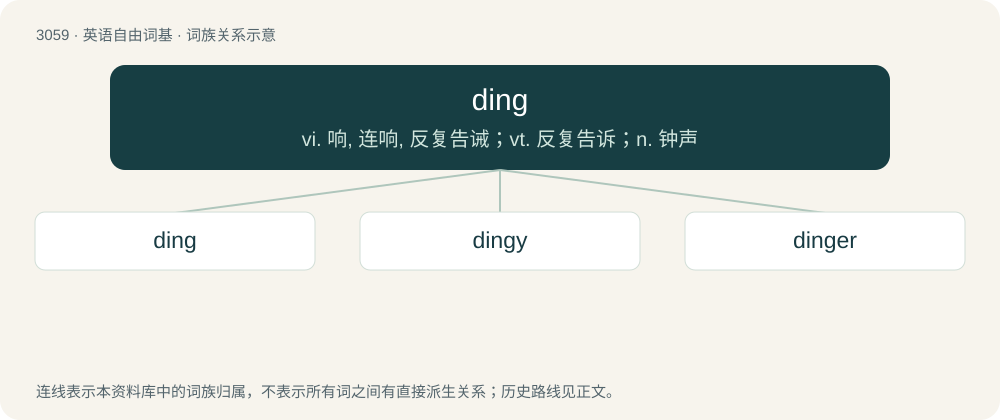

# 3155 · ding — vi. 响, 连响, 反复告诫；vt. 反复告诉；n. 钟声

[总目录](../00_总目录_按常用程度.md)

**类型**：英语自由词基　｜　**来源语言**：见词源记录

## 核心含义与来源

- 核心含义：vi. 响, 连响, 反复告诫；vt. 反复告诉；n. 钟声
- 英文含义：Very minor damage caused by being struck; a small dent or chip.
- 词形：ding

**多个词源／构词路径**：同一拼写可能有不同来源；以下按词性和含义分别列出。

**来源记录 1**（名词；Very minor damage caused by being struck; a small dent or chip.）

From Middle English dingen, dyngen (strong verb), from Old English \*dingan (“to ding”), from Proto-West Germanic \*dingwan, from Proto-Germanic \*dingwaną (“to beat”), from Proto-Indo-European \*dʰen- (“to beat, push”). Related to Old English denġan, denċġan (“to ding, knock, beat, strike”, weak verb) and Old Norse dengja (“to hammer”, weak verb); both from Proto-Germanic \*dangijaną (“to beat, hammer, peen”), causative of \*dingwaną. Cognate with Icelandic dengja (“to hammer”), Swedish dänga (“to bang, beat”), Danish dænge (“to bang, beat”), German tengeln, dengeln (“to peen”).

**来源记录 2**（名词；The high-pitched resonant sound of a bell.）

Onomatopoeic. Compare ding-dong,

**来源记录 3**（名词；An ancient Chinese vessel with legs and a lid.）

Romanized from Mandarin 鼎 (dǐng).

**来源记录 4**（名词；An indigenous inhabitant of the New Territories entitled to the building a village house under the Small House Policy.）

From Cantonese 丁 (ding¹).

## 词族图

## 单词速览（常用到不常用）

| 单词 | 音标 | 释义 |
|---|---|---|
| [ding](#w-1) | 英 /dɪŋ/ | vi. 响, 连响, 反复告诫；vt. 反复告诉；n. 钟声 |
| [dingy](#w-2) | /ˈdiŋdʒi/ | 【英文】Resembling or characteristic of a ding (the sound). |
| [dinger](#w-3) | 英 /ˈdɪŋ(ɡ)ə(ɹ)/ | n. 全垒打；n. (Dinger)人名；(英、德)丁格 |

## 逐词详解

### 1. ding

**词性**：名词　｜　**音标**：英 /dɪŋ/

**中文释义**：vi. 响, 连响, 反复告诫；vt. 反复告诉；n. 钟声

**英文义项**：Very minor damage caused by being struck; a small dent or chip. / A rejection.

**词源与演化**：

From Middle English dingen, dyngen (strong verb), from Old English \*dingan (“to ding”), from Proto-West Germanic \*dingwan, from Proto-Germanic \*dingwaną (“to beat”), from Proto-Indo-European \*dʰen- (“to beat, push”). Related to Old English denġan, denċġan (“to ding, knock, beat, strike”, weak verb) and Old Norse dengja (“to hammer”, weak verb); both from Proto-Germanic \*dangijaną (“to beat, hammer, peen”), causative of \*dingwaną. Cognate with Icelandic dengja (“to hammer”), Swedish dänga (“to bang, beat”), Danish dænge (“to bang, beat”), German tengeln, dengeln (“to peen”).

**例句**：

> I just got my first ding letter.

该用例对应义项：A rejection.

### 2. dingy

**词性**：形容词　｜　**音标**：/ˈdiŋdʒi/

**英文义项**：Resembling or characteristic of a ding (the sound).

**构词拆分**：ding + -y

**词源与演化**：

From ding + -y.

### 3. dinger

**词性**：名词　｜　**音标**：英 /ˈdɪŋ(ɡ)ə(ɹ)/

**中文释义**：n. 全垒打；n. (Dinger)人名；(英、德)丁格

**英文义项**：A bell or chime. / The suspended clapper of a bell.

**构词拆分**：From ding + -er.

**词源与演化**：

From ding + -er.

**例句**：

> Let′s leave them to sit on their dingers for a while.

该用例对应义项：The buttocks, the anus.
