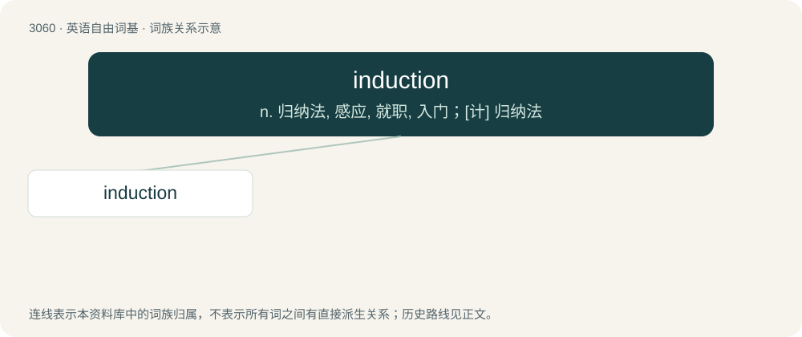

# 3156 · induction — n. 归纳法, 感应, 就职, 入门；\[计\] 归纳法

[总目录](../00_总目录_按常用程度.md)

**类型**：英语自由词基　｜　**来源语言**：见词源记录

## 核心含义与来源

- 核心含义：n. 归纳法, 感应, 就职, 入门；\[计\] 归纳法
- 英文含义：An act of inducting.
- 词形：induction

**来源记录 1**（名词；An act of inducting.）

Inherited from Middle English induction, from Old French induction, from Latin inductiō, from indūcō (“to lead”). By surface analysis, induct + -ion or induce + -tion.

## 词族图

## 单词速览（常用到不常用）

| 单词 | 音标 | 释义 |
|---|---|---|
| [induction](#w-1) | /ɪnˈdʌkʃən/ | n. 归纳法, 感应, 就职, 入门；\[计\] 归纳法 |

## 逐词详解

### 1. induction

**词性**：名词　｜　**音标**：/ɪnˈdʌkʃən/

**中文释义**：n. 归纳法, 感应, 就职, 入门；\[计\] 归纳法

**英文义项**：An act of inducting. / A formal ceremony in which a person is appointed to an office or into military service.

**构词拆分**：induce + -tion

**词源与演化**：

Inherited from Middle English induction, from Old French induction, from Latin inductiō, from indūcō (“to lead”). By surface analysis, induct + -ion or induce + -tion.

**例句**：

> He was ordered to report for induction into the army.

该用例对应义项：a formal entry into an organization or position or office
