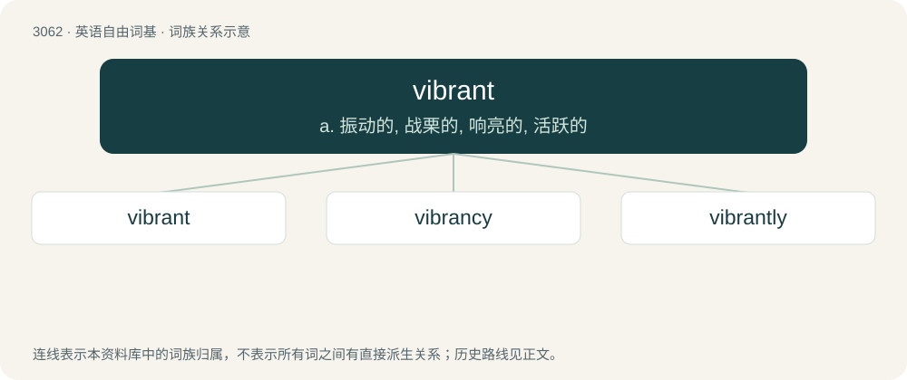

# 3158 · vibrant — a. 振动的, 战栗的, 响亮的, 活跃的

[总目录](../00_总目录_按常用程度.md)

**类型**：英语自由词基　｜　**来源语言**：见词源记录

## 核心含义与来源

- 核心含义：a. 振动的, 战栗的, 响亮的, 活跃的
- 英文含义：Pulsing with energy or activity.
- 词形：vibrant

**来源记录 1**（形容词；Pulsing with energy or activity.）

From French vibrant, from Latin vibrans, present participle of vibrare (“to vibrate”). See vibrate.

## 词族图

## 单词速览（常用到不常用）

| 单词 | 音标 | 释义 |
|---|---|---|
| [vibrant](#w-1) | /ˈvaɪbɹənt/ | a. 振动的, 战栗的, 响亮的, 活跃的 |
| [vibrancy](#w-2) | /ˈvaibrənsi/ | n. 振动, 振响, 活力 |
| [vibrantly](#w-3) |  | adv. 充满活力地 |

## 逐词详解

### 1. vibrant

**词性**：形容词　｜　**音标**：/ˈvaɪbɹənt/

**中文释义**：a. 振动的, 战栗的, 响亮的, 活跃的

**英文义项**：Pulsing with energy or activity. / Lively and vigorous.

**词源与演化**：

From French vibrant, from Latin vibrans, present participle of vibrare (“to vibrate”). See vibrate.

**例句**：

> He has a vibrant personality.

该用例对应义项：Pulsing with energy or activity.

### 2. vibrancy

**词性**：名词　｜　**音标**：/ˈvaibrənsi/

**中文释义**：n. 振动, 振响, 活力

**英文义项**：The quality of being vibrant.

**构词拆分**：vibrant + -cy

**词源与演化**：

From Latin vibrans, present participle of vibrare, equivalent to vibrant + -cy.

**例句**：

> Without you, my days would be colorless and monotonous. You bring vibrancy and excitement to my world.

### 3. vibrantly

**词性**：副词

**中文释义**：adv. 充满活力地

**英文义项**：In a vibrant manner.

**构词拆分**：vibrant + -ly

**词源与演化**：

From vibrant + -ly.

**例句**：

> In the wild, a well-fed flamingo is likely to have more vibrantly coloured plumage, which will more readily attract a mate.
