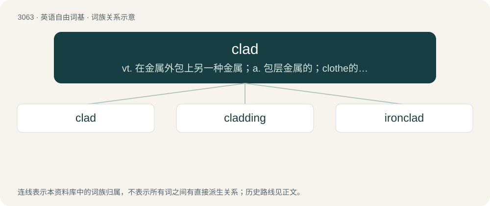

# 3161 · clad — vt. 在金属外包上另一种金属；a. 包层金属的；clothe的过去式和过去分词

[总目录](../00_总目录_按常用程度.md)

**类型**：英语自由词基　｜　**来源语言**：见词源记录

## 核心含义与来源

- 核心含义：vt. 在金属外包上另一种金属；a. 包层金属的；clothe的过去式和过去分词
- 英文含义：Wearing clothing or some other covering (for example, an armour) on the body; clothed, dressed.
- 词形：clad

**多个词源／构词路径**：同一拼写可能有不同来源；以下按词性和含义分别列出。

**来源记录 1**（形容词；Wearing clothing or some other covering (for example, an armour) on the body; clothed, dressed.）

From Middle English clad(d), cladde, clade, past tense and past participle forms of clathen, clothen (“to put clothing on, clothe, dress”), from \*clāþian (“to clothe”) (past participle ġeclāded, ġeclaþed, ġeclaþod), from clāþ, clǣþ (“cloth; (plural) clothes”); see further at etymology 1.

**来源记录 2**（动词；To cover with a cladding or another material (for example, insulation).）

Apparently derived from clad (adjective); see etymology 2. Uses of clad as the simple past and past participle form of clad are indistinguishable from uses of the word as the simple past and past participle form of clothe.

## 词族图

## 单词速览（常用到不常用）

| 单词 | 音标 | 释义 |
|---|---|---|
| [clad](#w-1) | 英 /klæd/ | vt. 在金属外包上另一种金属；a. 包层金属的；clothe的过去式和过去分词 |
| [cladding](#w-2) | /ˈklædɪŋ/ | n. 包层；\[计\] 包层, 敷箔, 覆盖 |
| [ironclad](#w-3) | /ˈaiənclæd/ | a. 装甲的, 铁定的；\[法\] 打不破, 装甲的, 镶铁的 |

## 逐词详解

### 1. clad

**词性**：形容词　｜　**音标**：英 /klæd/

**中文释义**：vt. 在金属外包上另一种金属；a. 包层金属的；clothe的过去式和过去分词

**英文义项**：Wearing clothing or some other covering (for example, an armour) on the body; clothed, dressed. / Covered, enveloped in, or surrounded by a cladding, or a specified material or substance.

**词源与演化**：

From Middle English clad(d), cladde, clade, past tense and past participle forms of clathen, clothen (“to put clothing on, clothe, dress”), from \*clāþian (“to clothe”) (past participle ġeclāded, ġeclaþed, ġeclaþod), from clāþ, clǣþ (“cloth; (plural) clothes”); see further at etymology 1.

**例句**：

> Nurses clad in white.

该用例对应义项：wearing or provided with clothing; sometimes used in combination

### 2. cladding

**词性**：名词　｜　**音标**：/ˈklædɪŋ/

**中文释义**：n. 包层；\[计\] 包层, 敷箔, 覆盖

**英文义项**：Clothing; clothes. / Any hard coating, bonded onto the outside of something to add protection, such as the plastic sheath around an optical fibre.

**构词拆分**：clad + -ing

**词源与演化**：

From clad + -ing. Compare clothing, ultimately from the same source.

### 3. ironclad

**词性**：形容词　｜　**音标**：/ˈaiənclæd/

**中文释义**：a. 装甲的, 铁定的；\[法\] 打不破, 装甲的, 镶铁的

**英文义项**：Covered with iron, steel, or (loosely) any other tough metal; armor-plated. / Solid or certain; not able to be disputed or questioned; irrefutable.

**构词拆分**：iron + clad

**词源与演化**：

From iron + clad.

**例句**：

> Unlike the average vehicle, cash delivery vans are ironclad and almost unstoppable.

该用例对应义项：Covered with iron, steel, or (loosely) any other tough metal; armor-plated.
