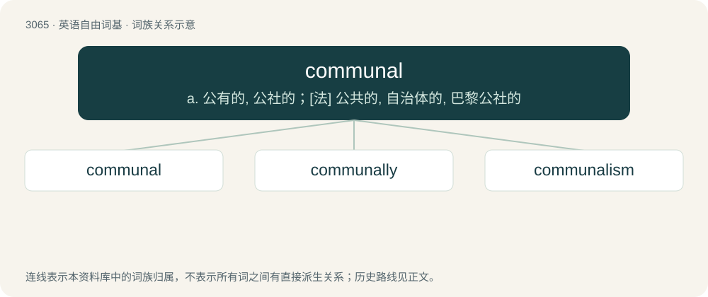

# 3162 · communal — a. 公有的, 公社的；\[法\] 公共的, 自治体的, 巴黎公社的

[总目录](../00_总目录_按常用程度.md)

**类型**：英语自由词基　｜　**来源语言**：见词源记录

## 核心含义与来源

- 核心含义：a. 公有的, 公社的；\[法\] 公共的, 自治体的, 巴黎公社的
- 英文含义：Pertaining to a community or a commune.
- 词形：communal

**来源记录 1**（形容词；Pertaining to a community or a commune.）

Borrowed from French communal, from Late Latin commūnālis, from Latin commūnis. Doublet of cominal.

## 词族图

## 单词速览（常用到不常用）

| 单词 | 音标 | 释义 |
|---|---|---|
| [communal](#w-1) | 英 /kəˈmjuː.nəl/；美 /kəˈmju.nəl/ | a. 公有的, 公社的；\[法\] 公共的, 自治体的, 巴黎公社的 |
| [communally](#w-2) |  | adv. 社区地；公有地 |
| [communalism](#w-3) | /ˈkɒmjunəlizm/ | n. 地方自治主义 |

## 逐词详解

### 1. communal

**词性**：形容词　｜　**音标**：英 /kəˈmjuː.nəl/；美 /kəˈmju.nəl/

**中文释义**：a. 公有的, 公社的；\[法\] 公共的, 自治体的, 巴黎公社的

**英文义项**：Pertaining to a community or a commune. / Shared by a community; public.

**词源与演化**：

Borrowed from French communal, from Late Latin commūnālis, from Latin commūnis. Doublet of cominal.

**用法示例／搭配（非完整句）**：

> communal violence

该用例对应义项：Defined by religious ideas; based on religion.

### 2. communally

**词性**：副词

**中文释义**：adv. 社区地；公有地

**英文义项**：Affecting, by, or on behalf of, a community or group of people, / Relating to religion

**构词拆分**：communal + -ly

**词源与演化**：

From communal + -ly.

**例句**：

> The mills were owned communally.

该用例对应义项：by a group of people rather than an individual

### 3. communalism

**词性**：名词　｜　**音标**：/ˈkɒmjunəlizm/

**中文释义**：n. 地方自治主义

**英文义项**：The communal ownership of property. / Any social system based around a community.

**构词拆分**：communal + -ism

**词源与演化**：

From communal + -ism.
