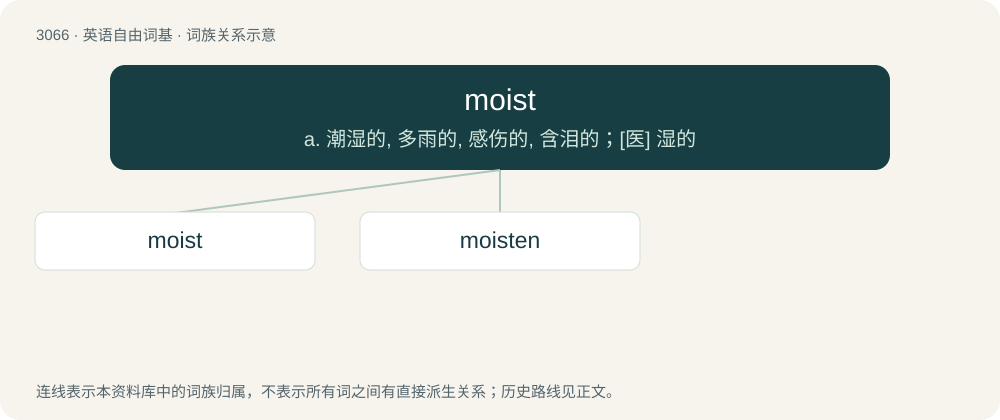

# 3163 · moist — a. 潮湿的, 多雨的, 感伤的, 含泪的；\[医\] 湿的

[总目录](../00_总目录_按常用程度.md)

**类型**：英语自由词基　｜　**来源语言**：见词源记录

## 核心含义与来源

- 核心含义：a. 潮湿的, 多雨的, 感伤的, 含泪的；\[医\] 湿的
- 英文含义：Characterized by the presence of moisture; not dry; slightly wet; damp.
- 词形：moist

**多个词源／构词路径**：同一拼写可能有不同来源；以下按词性和含义分别列出。

**来源记录 1**（形容词；Characterized by the presence of moisture; not dry; slightly wet; damp.）

The adjective is derived from Middle English moist, moiste \[and other forms\], from Anglo-Norman moist, moiste, moste, Middle French moiste, and Old French moiste, muste (“damp, moist, wet”) (modern French moite); further etymology uncertain, perhaps a blend of a Late Latin variant of Latin mūcidus (“mouldy, musty”) + a Late Latin derivative of Latin mustum (“unfermented or partially fermented grape juice or wine, must”). The noun is derived from the adjective.

**来源记录 2**（动词；To make (something) moist or wet; to moisten.）

From Middle English moisten, moist, moiste (“to make moist or wet; to soak in liquid; to become moist or wet; to provide with moisture or water; to satisfy thirst with liquor or water, slake”) \[and other forms\], and then either: \* from Anglo-Norman muster (“to make moist or wet”), Middle French moistir, and Old French moistir (“to make moist or wet; to become moist or wet”) (compare enmoistir; modern French moitir), from Old French moiste, muste (“damp, moist, wet”) (see etymology 1) + -ir (suffix forming infinitives of second conjugation verbs); or \* from Middle English moist, moiste (adjective) (see etymology 1), though the adjective is first attested later.

## 词族图

## 单词速览（常用到不常用）

| 单词 | 音标 | 释义 |
|---|---|---|
| [moist](#w-1) | 英 /mɔɪst/ | a. 潮湿的, 多雨的, 感伤的, 含泪的；\[医\] 湿的 |
| [moisten](#w-2) | /ˈmɔɪsən/ | vt. 弄湿；vi. 变潮湿 |

## 逐词详解

### 1. moist

**词性**：形容词　｜　**音标**：英 /mɔɪst/

**中文释义**：a. 潮湿的, 多雨的, 感伤的, 含泪的；\[医\] 湿的

**英文义项**：Characterized by the presence of moisture; not dry; slightly wet; damp. / Of eyes: wet with tears; tearful; also (obsolete), watery due to some illness or to old age.

**词源与演化**：

The adjective is derived from Middle English moist, moiste \[and other forms\], from Anglo-Norman moist, moiste, moste, Middle French moiste, and Old French moiste, muste (“damp, moist, wet”) (modern French moite); further etymology uncertain, perhaps a blend of a Late Latin variant of Latin mūcidus (“mouldy, musty”) + a Late Latin derivative of Latin mustum (“unfermented or partially fermented grape juice or wine, must”). The noun is derived from the adjective.

**例句**：

> Eyes moist with tears.

该用例对应义项：slightly wet

### 2. moisten

**词性**：动词　｜　**音标**：/ˈmɔɪsən/

**中文释义**：vt. 弄湿；vi. 变潮湿

**英文义项**：To make moist or moister. / To become moist or moister.

**构词拆分**：From moist + -en.

**词源与演化**：

From moist + -en.

**例句**：

> His eyes began to moisten as he held back tears.

该用例对应义项：To become moist or moister.
