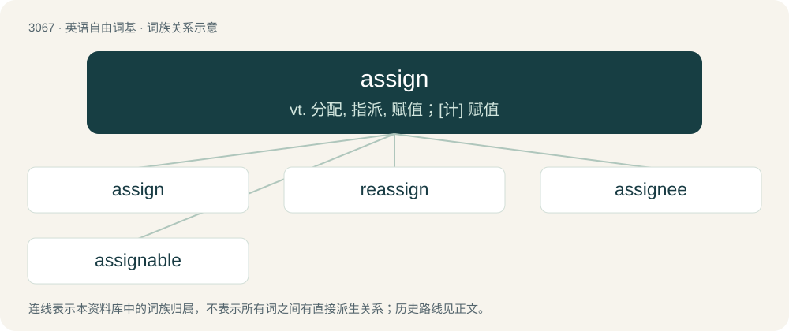

# 3164 · assign — vt. 分配, 指派, 赋值；\[计\] 赋值

[总目录](../00_总目录_按常用程度.md)

**类型**：英语自由词基　｜　**来源语言**：见词源记录

## 核心含义与来源

- 核心含义：vt. 分配, 指派, 赋值；\[计\] 赋值
- 英文含义：To designate or set apart (something) for some purpose.
- 词形：assign

**来源记录 1**（动词；To designate or set apart (something) for some purpose.）

From Middle English assignen, from Old French assigner, asigner, from Latin assignō, from ad- + signō (“mark, sign”).

## 词族图

## 单词速览（常用到不常用）

| 单词 | 音标 | 释义 |
|---|---|---|
| [assign](#w-1) | /əˈsaɪn/ | vt. 分配, 指派, 赋值；\[计\] 赋值 |
| [reassign](#w-2) | /.riːəˈsain/ | vt. 再分配, 再指定；\[经\] 转交, 转让 |
| [assignee](#w-3) | /,æsiˈniː/ | n. 受让人, 受托者, 代理人；\[经\] 受让人 |
| [assignable](#w-4) | /əˈsaɪnəbl̩/ | a. 可分配的, 可指定的, 可归属的；\[经\] 可以过户, 可分配的 |

## 逐词详解

### 1. assign

**词性**：动词　｜　**音标**：/əˈsaɪn/

**中文释义**：vt. 分配, 指派, 赋值；\[计\] 赋值

**英文义项**：To designate or set apart (something) for some purpose. / To appoint or select (someone) for some office.

**词源与演化**：

From Middle English assignen, from Old French assigner, asigner, from Latin assignō, from ad- + signō (“mark, sign”).

**例句**：

> We assign 100 to x.

该用例对应义项：To give (a value) to a variable.

### 2. reassign

**词性**：动词　｜　**音标**：/.riːəˈsain/

**中文释义**：vt. 再分配, 再指定；\[经\] 转交, 转让

**英文义项**：To assign again or anew. / To transfer back what was previously assigned.

**构词拆分**：re- + assign

**词源与演化**：

From re- + assign.

**例句**：

> The offending employees were reassigned after the incident.

该用例对应义项：To assign again or anew.

### 3. assignee

**词性**：名词　｜　**音标**：/,æsiˈniː/

**中文释义**：n. 受让人, 受托者, 代理人；\[经\] 受让人

**英文义项**：One to whom a thing is assigned. / One to whom a right or property is being transferred.

**构词拆分**：assign + -ee

**词源与演化**：

From Middle English assigne, from Old French assigné, equivalent to assign + -ee.

**例句**：

> The insurance claim cannot be processed until the assignee submits proper documentation.

### 4. assignable

**词性**：形容词　｜　**音标**：/əˈsaɪnəbl̩/

**中文释义**：a. 可分配的, 可指定的, 可归属的；\[经\] 可以过户, 可分配的

**英文义项**：Capable of being assigned (all senses). / Capable of being specified or shown.

**构词拆分**：assign + -able

**词源与演化**：

From assign + -able.

**例句**：

> In many programming languages, numeric values are not assignable to string variables.

该用例对应义项：Capable of being assigned (all senses).
