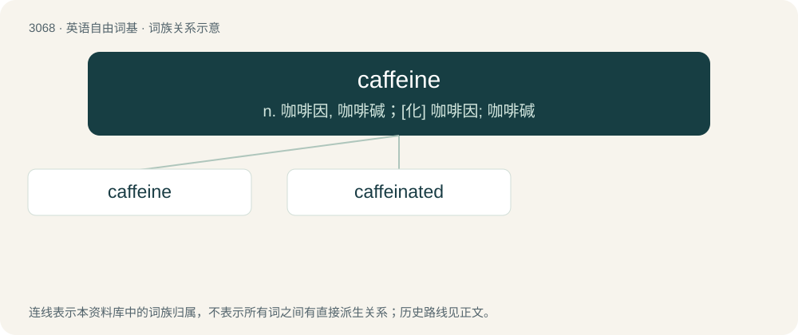

# 3165 · caffeine — n. 咖啡因, 咖啡碱；\[化\] 咖啡因; 咖啡碱

[总目录](../00_总目录_按常用程度.md)

**类型**：英语自由词基　｜　**来源语言**：见词源记录

## 核心含义与来源

- 核心含义：n. 咖啡因, 咖啡碱；\[化\] 咖啡因; 咖啡碱
- 英文含义：An alkaloid, C₈H₁₀N₄O₂, found naturally in tea and coffee plants, which acts as a mild stimulant on the central nervous system.
- 词形：caffeine

**来源记录 1**（名词；An alkaloid, C₈H₁₀N₄O₂, found naturally in tea and coffee plants, which acts as a mild stimulant on the central nervous system.）

Borrowed from French caféine, from café (“coffee”), or German Caffein, Kaffein (cp. Coffein, Koffein), from Kaffee (“coffee”) (cp. Kaffe, Koffee, Koffe), or Italian caffè (“coffee”) + -ine.

## 词族图

## 单词速览（常用到不常用）

| 单词 | 音标 | 释义 |
|---|---|---|
| [caffeine](#w-1) | /ˈkæfiːn/ | n. 咖啡因, 咖啡碱；\[化\] 咖啡因; 咖啡碱 |
| [caffeinated](#w-2) | /ˈkafɪneɪtɪd/ | a. 含咖啡因的 |

## 逐词详解

### 1. caffeine

**词性**：名词　｜　**音标**：/ˈkæfiːn/

**中文释义**：n. 咖啡因, 咖啡碱；\[化\] 咖啡因; 咖啡碱

**英文义项**：An alkaloid, C₈H₁₀N₄O₂, found naturally in tea and coffee plants, which acts as a mild stimulant on the central nervous system.

**词源与演化**：

Borrowed from French caféine, from café (“coffee”), or German Caffein, Kaffein (cp. Coffein, Koffein), from Kaffee (“coffee”) (cp. Kaffe, Koffee, Koffe), or Italian caffè (“coffee”) + -ine.

**例句**：

> Hildebrand says coffee is thought to contain other health-promoting substances besides caffeine.

### 2. caffeinated

**词性**：形容词　｜　**音标**：/ˈkafɪneɪtɪd/

**中文释义**：a. 含咖啡因的

**英文义项**：Containing caffeine naturally (e.g., coffee, tea, and cacao) or as an additive (e.g., soft drinks, sports drinks, or energy drinks). / Overly peppy or energetic; stimulated by caffeine.

**构词拆分**：caffeine + -ated

**词源与演化**：

From caffeine + -ated.

**例句**：

> I try not to drink caffeinated drinks very often.
