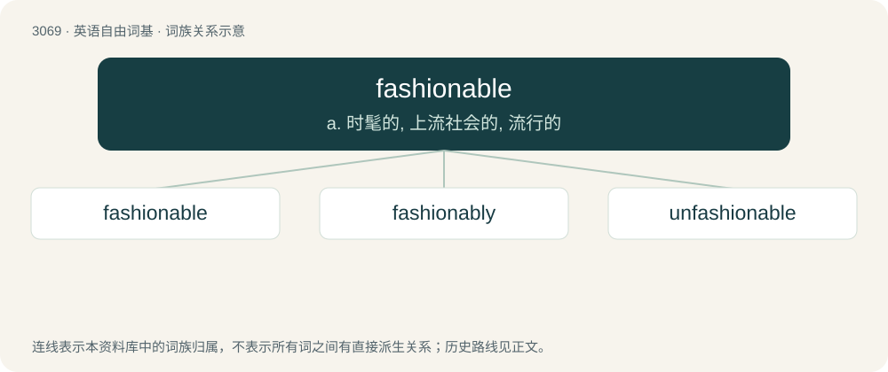

# 3166 · fashionable — a. 时髦的, 上流社会的, 流行的

[总目录](../00_总目录_按常用程度.md)

**类型**：英语自由词基　｜　**来源语言**：见词源记录

## 核心含义与来源

- 核心含义：a. 时髦的, 上流社会的, 流行的
- 英文含义：Characteristic of or influenced by a current popular trend or style; in fashion; in vogue.
- 词形：fashionable

**来源记录 1**（形容词；Characteristic of or influenced by a current popular trend or style; in fashion; in vogue.）

From fashion + -able.

## 词族图

## 单词速览（常用到不常用）

| 单词 | 音标 | 释义 |
|---|---|---|
| [fashionable](#w-1) | /ˈfæʃənəbl̩/ | a. 时髦的, 上流社会的, 流行的 |
| [fashionably](#w-2) | /ˈfæʃənəbli/ | adv. 时髦地, 按照流行地 |
| [unfashionable](#w-3) | /.ʌnˈfæʃənəbl/ | a. 不流行的, 不时髦的, 过时的 |

## 逐词详解

### 1. fashionable

**词性**：形容词　｜　**音标**：/ˈfæʃənəbl̩/

**中文释义**：a. 时髦的, 上流社会的, 流行的

**英文义项**：Characteristic of or influenced by a current popular trend or style; in fashion; in vogue. / Established or favoured by custom or use; current; prevailing at a particular time.

**构词拆分**：fashion + -able

**词源与演化**：

From fashion + -able.

**用法示例／搭配（非完整句）**：

> the fashionable philosophy

该用例对应义项：Established or favoured by custom or use; current; prevailing at a particular time.

### 2. fashionably

**词性**：副词　｜　**音标**：/ˈfæʃənəbli/

**中文释义**：adv. 时髦地, 按照流行地

**英文义项**：In a fashionable manner.

**构词拆分**：fashionable + -ly

**词源与演化**：

From fashionable + -ly.

**例句**：

> His voice had no trace of the drawl that you would expect to find in a fashionably dressed young man.

该用例对应义项：in a fashionable manner

### 3. unfashionable

**词性**：形容词　｜　**音标**：/.ʌnˈfæʃənəbl/

**中文释义**：a. 不流行的, 不时髦的, 过时的

**英文义项**：Not fashionable.

**构词拆分**：un- + fashionable

**词源与演化**：

From un- + fashionable.

**例句**：

> Melodrama of a now unfashionable kind.

该用例对应义项：not in accord with or not following current fashion
