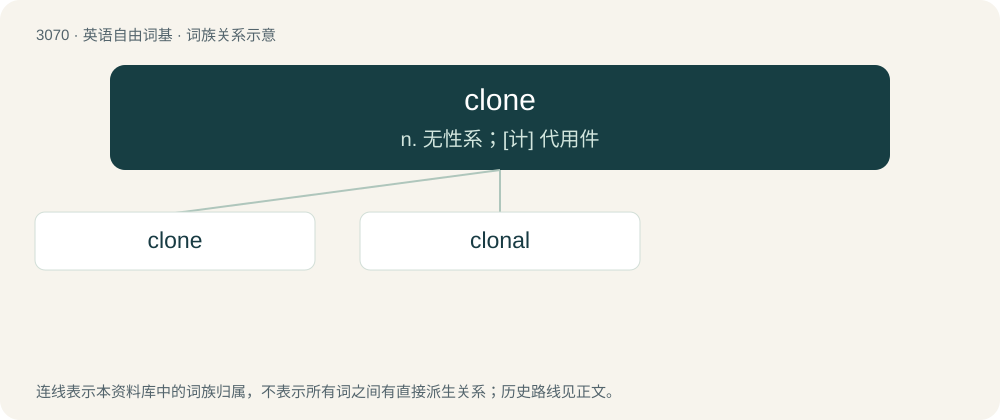

# 3169 · clone — n. 无性系；\[计\] 代用件

[总目录](../00_总目录_按常用程度.md)

**类型**：英语自由词基　｜　**来源语言**：见词源记录

## 核心含义与来源

- 核心含义：n. 无性系；\[计\] 代用件
- 英文含义：A living organism (originally a plant) produced asexually from a single ancestor, to which it is genetically identical.
- 词形：clone

**来源记录 1**（名词；A living organism (originally a plant) produced asexually from a single ancestor, to which it is genetically identical.）

Coined (in botany) in 1903, based on Ancient Greek κλών (klṓn, “twig”). Figurative use from the 1970s.

## 词族图

## 单词速览（常用到不常用）

| 单词 | 音标 | 释义 |
|---|---|---|
| [clone](#w-1) | 英 /kləʊn/；美 /kloʊn/ | n. 无性系；\[计\] 代用件 |
| [clonal](#w-2) | 英 /ˈkləʊnəl/；美 /ˈkloʊnəl/ | a. 无性系的, 克隆的；\[医\] 无性系的, 纯系的 |

## 逐词详解

### 1. clone

**词性**：名词　｜　**音标**：英 /kləʊn/；美 /kloʊn/

**中文释义**：n. 无性系；\[计\] 代用件

**英文义项**：A living organism (originally a plant) produced asexually from a single ancestor, to which it is genetically identical. / A group of identical cells derived from a single cell.

**词源与演化**：

Coined (in botany) in 1903, based on Ancient Greek κλών (klṓn, “twig”). Figurative use from the 1970s.

**例句**：

> The computer manufacturer produced IBM PC clones in the 1990s.

该用例对应义项：A copy or imitation of something already existing, especially when designed to simulate it.

### 2. clonal

**词性**：形容词　｜　**音标**：英 /ˈkləʊnəl/；美 /ˈkloʊnəl/

**中文释义**：a. 无性系的, 克隆的；\[医\] 无性系的, 纯系的

**英文义项**：Relating to, or created by asexual reproduction (cloning) / That lives with others of the same kind

**构词拆分**：From clone + -al.

**词源与演化**：

From clone + -al.
