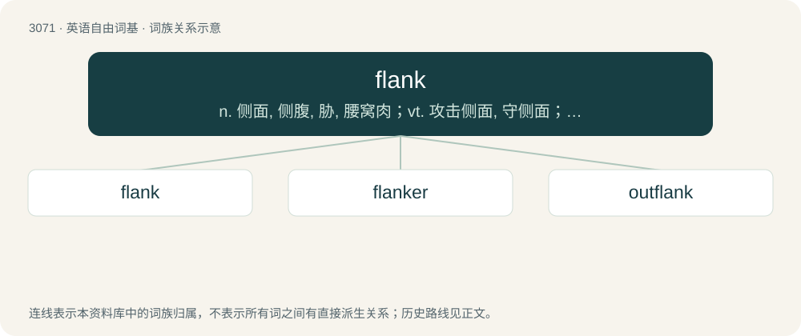

# 3170 · flank — n. 侧面, 侧腹, 胁, 腰窝肉；vt. 攻击侧面, 守侧面；vi. 侧面与...相接

[总目录](../00_总目录_按常用程度.md)

**类型**：英语自由词基　｜　**来源语言**：见词源记录

## 核心含义与来源

- 核心含义：n. 侧面, 侧腹, 胁, 腰窝肉；vt. 攻击侧面, 守侧面；vi. 侧面与...相接
- 英文含义：To attack the flank(s) of.
- 词形：flank

**来源记录 1**（动词；To attack the flank(s) of.）

From Late Middle English flanc, from Late Old English flanc (“flank”), from Old French flanc, of Germanic origin, probably Frankish \*hlanca, from Proto-West Germanic \*hlanku (“bend, curve, hip, flank”), from Proto-Germanic \*hlankaz (“flexible, sleek, bendsome”), from Proto-Indo-European \*kleng- (“to bend”). Akin to Old High German hlanca (“loin”), Middle Low German lanke (“hip joint”) (German lenken (“to bend, turn, lead”)), Old English hlanc (“loose, slender, flaccid, lank”). More at lank.

## 词族图

## 单词速览（常用到不常用）

| 单词 | 音标 | 释义 |
|---|---|---|
| [flank](#w-1) | 英 /flænk/；美 /flæŋk/ | n. 侧面, 侧腹, 胁, 腰窝肉；vt. 攻击侧面, 守侧面；vi. 侧面与...相接 |
| [flanker](#w-2) | 英 /ˈflæŋkə/；美 /ˈflæŋkɚ/ | n. 侧面堡垒, 侧面部队, 侧冲 |
| [outflank](#w-3) | /.autˈflæŋk/ | vt. 包抄, 迂回, 智胜 |

## 逐词详解

### 1. flank

**词性**：形容词　｜　**音标**：英 /flænk/；美 /flæŋk/

**中文释义**：n. 侧面, 侧腹, 胁, 腰窝肉；vt. 攻击侧面, 守侧面；vi. 侧面与...相接

**英文义项**：Maximum. Historically faster than full speed (the most a vessel can sustain without excessive engine wear or risk of damage), now frequently used interchangeably. Typically used in an emergency or during an attack.

**词源与演化**：

From Late Middle English flanc, from Late Old English flanc (“flank”), from Old French flanc, of Germanic origin, probably Frankish \*hlanca, from Proto-West Germanic \*hlanku (“bend, curve, hip, flank”), from Proto-Germanic \*hlankaz (“flexible, sleek, bendsome”), from Proto-Indo-European \*kleng- (“to bend”). Akin to Old High German hlanca (“loin”), Middle Low German lanke (“hip joint”) (German lenken (“to bend, turn, lead”)), Old English hlanc (“loose, slender, flaccid, lank”). More at lank.

**用法示例／搭配（非完整句）**：

> All ahead flank!

该用例对应义项：Maximum. Historically faster than full speed (the most a vessel can sustain without excessive engine wear or risk of damage), now frequently used interchangeably. Typically used in an emergency or during an attack.

### 2. flanker

**词性**：名词　｜　**音标**：英 /ˈflæŋkə/；美 /ˈflæŋkɚ/

**中文释义**：n. 侧面堡垒, 侧面部队, 侧冲

**英文义项**：A player who plays in the back row of the scrum. / A wide receiver who lines up behind the line of scrimmage.

**构词拆分**：flank + -er

**词源与演化**：

From flank + -er. The verb is from the noun (sense 3).

### 3. outflank

**词性**：动词　｜　**音标**：/.autˈflæŋk/

**中文释义**：vt. 包抄, 迂回, 智胜

**英文义项**：To maneuver around and behind the flank of (an opposing force). / To gain a tactical advantage over (a competitor, for example).

**构词拆分**：out- + flank

**词源与演化**：

From out- + flank.
