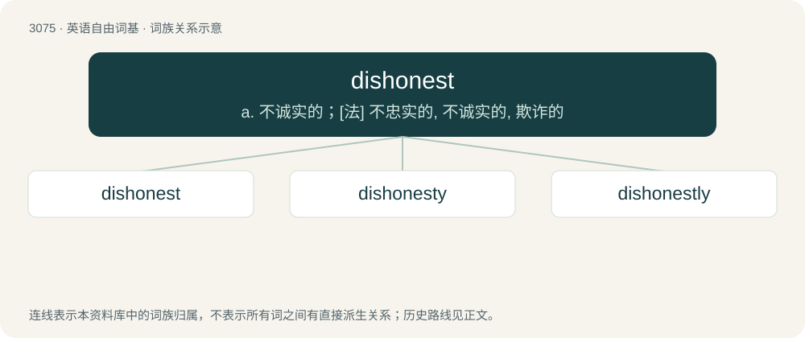

# 3175 · dishonest — a. 不诚实的；\[法\] 不忠实的, 不诚实的, 欺诈的

[总目录](../00_总目录_按常用程度.md)

**类型**：英语自由词基　｜　**来源语言**：见词源记录

## 核心含义与来源

- 核心含义：a. 不诚实的；\[法\] 不忠实的, 不诚实的, 欺诈的
- 英文含义：Not honest; shoddy.
- 词形：dishonest

**来源记录 1**（形容词；Not honest; shoddy.）

From Middle English dishoneste (“dishonourable”), from Old French deshoneste, from Latin dehonestus. Equivalent to dis- + honest. Displaced native Old English unsōþfæst.

## 词族图

## 单词速览（常用到不常用）

| 单词 | 音标 | 释义 |
|---|---|---|
| [dishonest](#w-1) | 英 /dɪˈsɒnɪst/；美 /dɪˈsɑnɪst/ | a. 不诚实的；\[法\] 不忠实的, 不诚实的, 欺诈的 |
| [dishonesty](#w-2) | /dɪsˈɒnɪ.sti/ | n. 不诚实；\[法\] 不诚实, 诈欺, 不正 |
| [dishonestly](#w-3) | /dɪsˈɒnɪstli/ | adv. 不诚实地, 不正直地 |

## 逐词详解

### 1. dishonest

**词性**：形容词　｜　**音标**：英 /dɪˈsɒnɪst/；美 /dɪˈsɑnɪst/

**中文释义**：a. 不诚实的；\[法\] 不忠实的, 不诚实的, 欺诈的

**英文义项**：Not honest; shoddy. / Interfering with honesty.

**构词拆分**：dis- + honest

**词源与演化**：

From Middle English dishoneste (“dishonourable”), from Old French deshoneste, from Latin dehonestus. Equivalent to dis- + honest. Displaced native Old English unsōþfæst.

**例句**：

> There are no dishonest people, only ones who forget to be honest.

### 2. dishonesty

**词性**：名词　｜　**音标**：/dɪsˈɒnɪ.sti/

**中文释义**：n. 不诚实；\[法\] 不诚实, 诈欺, 不正

**英文义项**：The characteristic or condition of being dishonest. / An act which is fraudulent or otherwise dishonest.

**构词拆分**：dis- + honesty；dishonest + -y

**词源与演化**：

From Middle English dishoneste (“disgrace, filth”), from Old French deshoneste, equivalent to dis- + honesty or dishonest + -y.

**例句**：

> He denounced all forms of dishonesty in government.

### 3. dishonestly

**词性**：副词　｜　**音标**：/dɪsˈɒnɪstli/

**中文释义**：adv. 不诚实地, 不正直地

**英文义项**：In a dishonest manner.

**构词拆分**：dishonest + -ly

**词源与演化**：

From Middle English dishonestly (“disgracefully”); equivalent to dishonest + -ly.

**例句**：

> He acted dishonestly when he gave the contract to his best friend.

该用例对应义项：in a corrupt and deceitful manner
