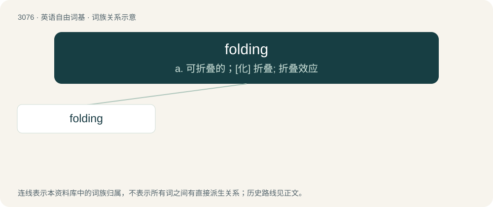

# 3176 · folding — a. 可折叠的；\[化\] 折叠; 折叠效应

[总目录](../00_总目录_按常用程度.md)

**类型**：英语自由词基　｜　**来源语言**：见词源记录

## 核心含义与来源

- 核心含义：a. 可折叠的；\[化\] 折叠; 折叠效应
- 英文含义：Designed to fold
- 词形：folding

**来源记录 1**（形容词；Designed to fold）

By surface analysis, fold + -ing.

## 词族图

## 单词速览（常用到不常用）

| 单词 | 音标 | 释义 |
|---|---|---|
| [folding](#w-1) | 英 /ˈfəʊldɪŋ/；美 /ˈfoʊldɪŋ/ | a. 可折叠的；\[化\] 折叠; 折叠效应 |

## 逐词详解

### 1. folding

**词性**：形容词　｜　**音标**：英 /ˈfəʊldɪŋ/；美 /ˈfoʊldɪŋ/

**中文释义**：a. 可折叠的；\[化\] 折叠; 折叠效应

**英文义项**：Designed to fold

**词源与演化**：

By surface analysis, fold + -ing.

**用法示例／搭配（非完整句）**：

> a folding bed, a folding bicycle, a folding chair

该用例对应义项：Designed to fold
