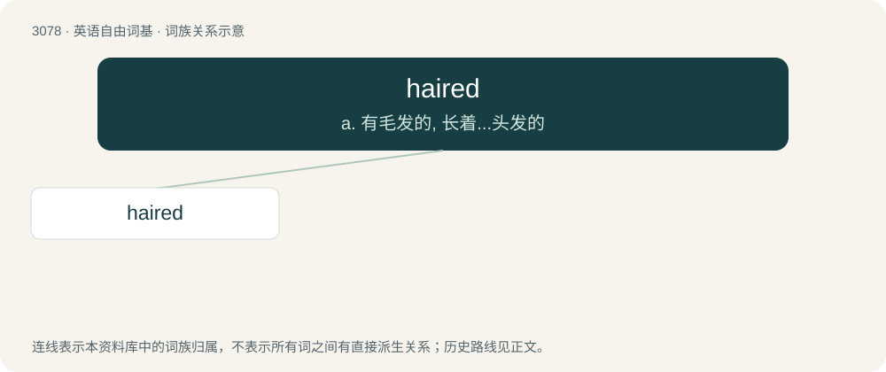

# 3177 · haired — a. 有毛发的, 长着...头发的

[总目录](../00_总目录_按常用程度.md)

**类型**：英语自由词基　｜　**来源语言**：见词源记录

## 核心含义与来源

- 核心含义：a. 有毛发的, 长着...头发的
- 英文含义：Bearing one's own hair as grown and yet attached; neither bald nor hairless.
- 词形：haired

**来源记录 1**（形容词；Bearing one's own hair as grown and yet attached; neither bald nor hairless.）

From Middle English hered, equivalent to hair + -ed. Compare Dutch behaard (“haired”), German behaart (“haired”).

## 词族图

## 单词速览（常用到不常用）

| 单词 | 音标 | 释义 |
|---|---|---|
| [haired](#w-1) | 英 /hɛəd/；美 /hɛɹd/ | a. 有毛发的, 长着...头发的 |

## 逐词详解

### 1. haired

**词性**：形容词　｜　**音标**：英 /hɛəd/；美 /hɛɹd/

**中文释义**：a. 有毛发的, 长着...头发的

**英文义项**：Bearing one's own hair as grown and yet attached; neither bald nor hairless. / Bearing some specific type of hair.

**构词拆分**：hair + -ed

**词源与演化**：

From Middle English hered, equivalent to hair + -ed. Compare Dutch behaard (“haired”), German behaart (“haired”).

**例句**：

> She was a raven-haired beauty.

该用例对应义项：Bearing some specific type of hair.
