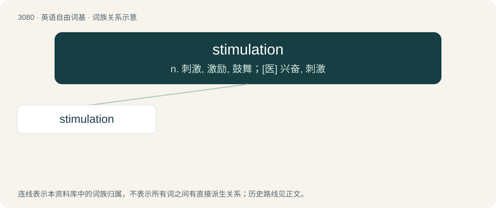

# 3179 · stimulation — n. 刺激, 激励, 鼓舞；\[医\] 兴奋, 刺激

[总目录](../00_总目录_按常用程度.md)

**类型**：英语自由词基　｜　**来源语言**：见词源记录

## 核心含义与来源

- 核心含义：n. 刺激, 激励, 鼓舞；\[医\] 兴奋, 刺激
- 英文含义：A pushing or goading toward action.
- 词形：stimulation

**来源记录 1**（名词；A pushing or goading toward action.）

From Latin stimulātiō. Morphologically stimulate + -ion.

## 词族图

## 单词速览（常用到不常用）

| 单词 | 音标 | 释义 |
|---|---|---|
| [stimulation](#w-1) | 英 /stɪm.jʊˈleɪ.ʃən/；美 /ˈstɪm.jəˈleɪ.ʃən/ | n. 刺激, 激励, 鼓舞；\[医\] 兴奋, 刺激 |

## 逐词详解

### 1. stimulation

**词性**：名词　｜　**音标**：英 /stɪm.jʊˈleɪ.ʃən/；美 /ˈstɪm.jəˈleɪ.ʃən/

**中文释义**：n. 刺激, 激励, 鼓舞；\[医\] 兴奋, 刺激

**英文义项**：A pushing or goading toward action. / Any action or condition that creates a response; sensory input.

**构词拆分**：stimulate + -ion

**词源与演化**：

From Latin stimulātiō. Morphologically stimulate + -ion.

**例句**：

> We spend hours scrolling through social media because our brains need stimulation.
