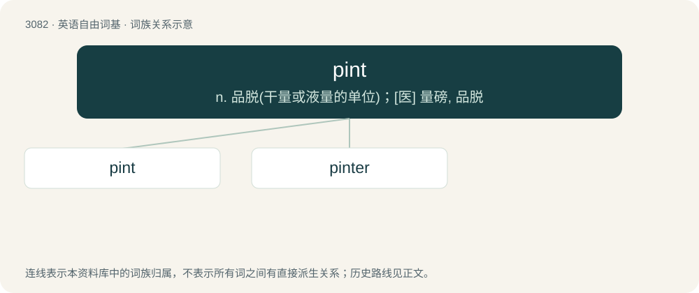

# 3181 · pint — n. 品脱(干量或液量的单位)；\[医\] 量磅, 品脱

[总目录](../00_总目录_按常用程度.md)

**类型**：英语自由词基　｜　**来源语言**：见词源记录

## 核心含义与来源

- 核心含义：n. 品脱(干量或液量的单位)；\[医\] 量磅, 品脱
- 英文含义：20 fluid ounces, approximately 568 millilitres (an imperial pint).
- 词形：pint

**来源记录 1**（名词；20 fluid ounces, approximately 568 millilitres (an imperial pint).）

From Middle English pinte, from Old French pinte, assumed from Vulgar Latin \*pincta (“a mark used to indicate a level of quantity against a larger measure”), from Latin picta (“painted”), from Latin pingō (“paint”, verb). Doublet of pinto and Pinto.

## 词族图

## 单词速览（常用到不常用）

| 单词 | 音标 | 释义 |
|---|---|---|
| [pint](#w-1) | /paɪnt/ | n. 品脱(干量或液量的单位)；\[医\] 量磅, 品脱 |
| [pinter](#w-2) |  | 【英文】The drinking of a certain number of pints of beer |

## 逐词详解

### 1. pint

**词性**：名词　｜　**音标**：/paɪnt/

**中文释义**：n. 品脱(干量或液量的单位)；\[医\] 量磅, 品脱

**英文义项**：20 fluid ounces, approximately 568 millilitres (an imperial pint). / 16 US fluid ounces \[473 millilitres\] for liquids (a US liquid pint) or

**词源与演化**：

From Middle English pinte, from Old French pinte, assumed from Vulgar Latin \*pincta (“a mark used to indicate a level of quantity against a larger measure”), from Latin picta (“painted”), from Latin pingō (“paint”, verb). Doublet of pinto and Pinto.

**例句**：

> Please leave three pints tomorrow, milkman.

该用例对应义项：A pint of milk.

### 2. pinter

**词性**：名词

**英文义项**：The drinking of a certain number of pints of beer / A container that holds a certain number of pints.

**构词拆分**：pint + -er

**词源与演化**：

From pint + -er.

**例句**：

> She's so ugly, an eight-pinter, I'd say.

该用例对应义项：Something that takes a certain number of pints of beer to appreciate.
