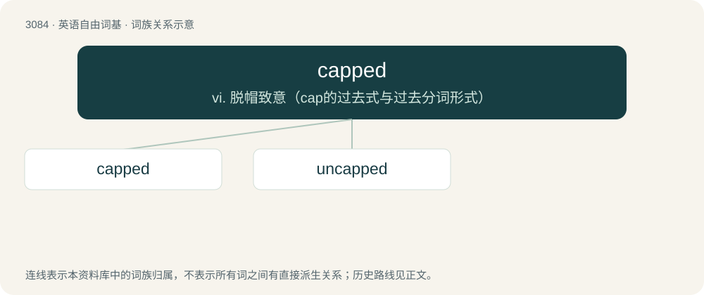

# 3183 · capped — vi. 脱帽致意（cap的过去式与过去分词形式）

[总目录](../00_总目录_按常用程度.md)

**类型**：英语自由词基　｜　**来源语言**：见词源记录

## 核心含义与来源

- 核心含义：vi. 脱帽致意（cap的过去式与过去分词形式）
- 英文含义：Having a cap (various senses).
- 词形：capped

**来源记录 1**（形容词；Having a cap (various senses).）

From cap + -ed. Piecewise doublet of caped, chaped, and coped.

## 词族图

## 单词速览（常用到不常用）

| 单词 | 音标 | 释义 |
|---|---|---|
| [capped](#w-1) | 英 /kapt/；美 /kæpt/ | vi. 脱帽致意（cap的过去式与过去分词形式） |
| [uncapped](#w-2) | /ˈʌnkæpt/ | a. 未授予队员帽的（队员） |

## 逐词详解

### 1. capped

**词性**：形容词　｜　**音标**：英 /kapt/；美 /kæpt/

**中文释义**：vi. 脱帽致意（cap的过去式与过去分词形式）

**英文义项**：Having a cap (various senses).

**构词拆分**：cap + -ed

**词源与演化**：

From cap + -ed. Piecewise doublet of caped, chaped, and coped.

**例句**：

> Capped teeth gave her a beautiful smile.

该用例对应义项：used especially of front teeth having (artificial) crowns

### 2. uncapped

**词性**：形容词　｜　**音标**：/ˈʌnkæpt/

**中文释义**：a. 未授予队员帽的（队员）

**英文义项**：Not capped (in various senses); not wearing or possessing a cap. / Of honey, not having been sealed by bees with a wax cover in the cell.

**构词拆分**：un- + capped

**词源与演化**：

From un- + capped. Piecewise doublet of uncaped and uncoped.
