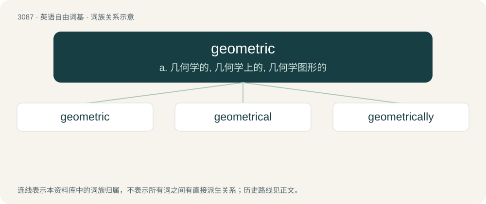

# 3185 · geometric — a. 几何学的, 几何学上的, 几何学图形的

[总目录](../00_总目录_按常用程度.md)

**类型**：英语自由词基　｜　**来源语言**：见词源记录

## 核心含义与来源

- 核心含义：a. 几何学的, 几何学上的, 几何学图形的
- 英文含义：Of or relating to geometry.
- 词形：geometric

**来源记录 1**（形容词；Of or relating to geometry.）

From Latin geōmetricus, from Ancient Greek γεωμετρικός (geōmetrikós), from γεωμέτρης (geōmétrēs). By surface analysis, geometer + -ic or geo- + -metric.

## 词族图

## 单词速览（常用到不常用）

| 单词 | 音标 | 释义 |
|---|---|---|
| [geometric](#w-1) | 英 /ˌd͡ʒiː.əʊˈmɛt.ɹɪk/；美 /ˌd͡ʒi.oʊˈmɛt.ɹɪk/ | a. 几何学的, 几何学上的, 几何学图形的 |
| [geometrical](#w-2) | /ˌd͡ʒi.oʊˈmɛt.ɹɪk.əl/ | a. 几何学的, 几何的；\[机\] 几何学的 |
| [geometrically](#w-3) | /dʒiəˈmetrikli/ | adv. 用几何学, 几何学上 |

## 逐词详解

### 1. geometric

**词性**：形容词　｜　**音标**：英 /ˌd͡ʒiː.əʊˈmɛt.ɹɪk/；美 /ˌd͡ʒi.oʊˈmɛt.ɹɪk/

**中文释义**：a. 几何学的, 几何学上的, 几何学图形的

**英文义项**：Of or relating to geometry. / Increasing or decreasing in a geometric progression.

**构词拆分**：geo- + -metric

**词源与演化**：

From Latin geōmetricus, from Ancient Greek γεωμετρικός (geōmetrikós), from γεωμέτρης (geōmétrēs). By surface analysis, geometer + -ic or geo- + -metric.

**例句**：

> Bacteria exhibit geometric increase in numbers when the environment is not limiting.

该用例对应义项：Increasing or decreasing in a geometric progression.

### 2. geometrical

**词性**：形容词　｜　**音标**：/ˌd͡ʒi.oʊˈmɛt.ɹɪk.əl/

**中文释义**：a. 几何学的, 几何的；\[机\] 几何学的

**英文义项**：Of, or relating to geometry; geometric. / Consisting of lines and simple shapes.

**构词拆分**：From geometric + -al.

**词源与演化**：

From geometric + -al.

**例句**：

> The spiral is one of the most common geometrical forms in nature.

### 3. geometrically

**词性**：副词　｜　**音标**：/dʒiəˈmetrikli/

**中文释义**：adv. 用几何学, 几何学上

**英文义项**：In a geometric manner. / Concerning geometrics.

**构词拆分**：geometric + -ally

**词源与演化**：

From geometric + -ally.
