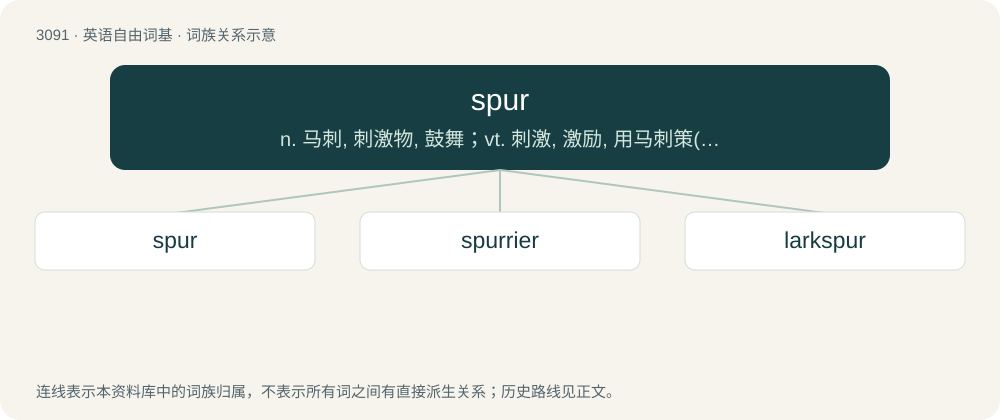

# 3187 · spur — n. 马刺, 刺激物, 鼓舞；vt. 刺激, 激励, 用马刺策(马)前进；vi. 用马刺驱马, 疾驰

[总目录](../00_总目录_按常用程度.md)

**类型**：英语自由词基　｜　**来源语言**：见词源记录

## 核心含义与来源

- 核心含义：n. 马刺, 刺激物, 鼓舞；vt. 刺激, 激励, 用马刺策(马)前进；vi. 用马刺驱马, 疾驰
- 英文含义：A rigid implement, often roughly y-shaped, that is fixed to one's heel for the purpose of prodding a horse. Often worn by, and emblematic of, the cowboy or the knight.
- 词形：spur

**多个词源／构词路径**：同一拼写可能有不同来源；以下按词性和含义分别列出。

**来源记录 1**（名词；A rigid implement, often roughly y-shaped, that is fixed to one's heel for the purpose of prodding a horse. Often worn by, and emblematic of, the cowboy or the knight.）

From Middle English spure, spore, from Old English spora, spura, from Proto-West Germanic \*spurō, from Proto-Germanic \*spurô, from Proto-Indo-European \*sperH- (“to kick”).

**来源记录 2**（名词；A tern.）

See sparrow.

**来源记录 3**（名词；A spurious tone, one that interferes with a signal in a circuit and is often masked underneath that signal.）

Short for spurious.

## 词族图

## 单词速览（常用到不常用）

| 单词 | 音标 | 释义 |
|---|---|---|
| [spur](#w-1) | 英 /spɜː/；美 /spɝ/ | n. 马刺, 刺激物, 鼓舞；vt. 刺激, 激励, 用马刺策(马)前进；vi. 用马刺驱马, 疾驰 |
| [spurrier](#w-2) | 英 /ˈspʌɹiə(ɹ)/；美 /ˈspɝɹiɚ/ | n. 马刺制造者 |
| [larkspur](#w-3) | 美 /ˈlɑɹk.spɚ/ | n. 翠雀属植物；\[医\] 飞燕草子 |

## 逐词详解

### 1. spur

**词性**：动词　｜　**音标**：英 /spɜː/；美 /spɝ/

**中文释义**：n. 马刺, 刺激物, 鼓舞；vt. 刺激, 激励, 用马刺策(马)前进；vi. 用马刺驱马, 疾驰

**英文义项**：To prod (especially a horse) on the side or flank, with the intent to urge motion or haste, to gig. / To urge or encourage to action, or to a more vigorous pursuit of an object

**词源与演化**：

From Middle English spure, spore, from Old English spora, spura, from Proto-West Germanic \*spurō, from Proto-Germanic \*spurô, from Proto-Indo-European \*sperH- (“to kick”).

**用法示例／搭配（非完整句）**：

> to spur boots

该用例对应义项：To put spurs on.

### 2. spurrier

**词性**：名词　｜　**音标**：英 /ˈspʌɹiə(ɹ)/；美 /ˈspɝɹiɚ/

**中文释义**：n. 马刺制造者

**英文义项**：A maker of spurs.

**构词拆分**：spur + -ier

**词源与演化**：

From Middle English sporiere; equivalent to spur + -ier.

### 3. larkspur

**词性**：名词　｜　**音标**：美 /ˈlɑɹk.spɚ/

**中文释义**：n. 翠雀属植物；\[医\] 飞燕草子

**英文义项**：A delphinium: any plant of the genus Delphinium, especially Delphinium ajacis and other plants of the subgenus Delphinium subg. Consolida

**构词拆分**：lark + spur

**词源与演化**：

From lark + spur, so named for the spur's shape, which resembles the hind toe of a lark.

**例句**：

> The article about planting larkspur neglected to mention how the flowers could be deadly if eaten.
