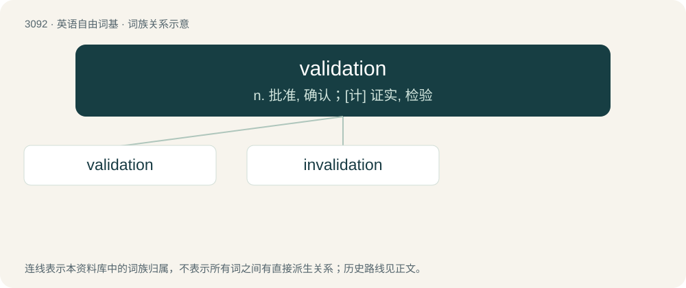

# 3188 · validation — n. 批准, 确认；\[计\] 证实, 检验

[总目录](../00_总目录_按常用程度.md)

**类型**：英语自由词基　｜　**来源语言**：见词源记录

## 核心含义与来源

- 核心含义：n. 批准, 确认；\[计\] 证实, 检验
- 英文含义：The act of validating something.
- 词形：validation

**来源记录 1**（名词；The act of validating something.）

From Middle French validation. By surface analysis, validate + -ion.

## 词族图

## 单词速览（常用到不常用）

| 单词 | 音标 | 释义 |
|---|---|---|
| [validation](#w-1) | 英 /ˌvæl.əˈdeɪ.ʃən/ | n. 批准, 确认；\[计\] 证实, 检验 |
| [invalidation](#w-2) | 美 /ɪnˌvæl.əˈdeɪ.ʃən/ | n. 无效, 失效；\[法\] 无效, 作废 |

## 逐词详解

### 1. validation

**词性**：名词　｜　**音标**：英 /ˌvæl.əˈdeɪ.ʃən/

**中文释义**：n. 批准, 确认；\[计\] 证实, 检验

**英文义项**：The act of validating something. / Something, such as a certificate, that validates something; attestation, authentication, confirmation, proof or verification.

**词源与演化**：

From Middle French validation. By surface analysis, validate + -ion.

**例句**：

> Yanni says he isn't getting the validation that he needs from Skura.

### 2. invalidation

**词性**：名词　｜　**音标**：美 /ɪnˌvæl.əˈdeɪ.ʃən/

**中文释义**：n. 无效, 失效；\[法\] 无效, 作废

**英文义项**：The act of invalidating, or the state of being invalidated

**构词拆分**：invalidate + -ion；in- + validation

**词源与演化**：

From invalidate + -ion or in- + validation.

**例句**：

> There will be no invalidation or othering of BIPOC at this meeting.
