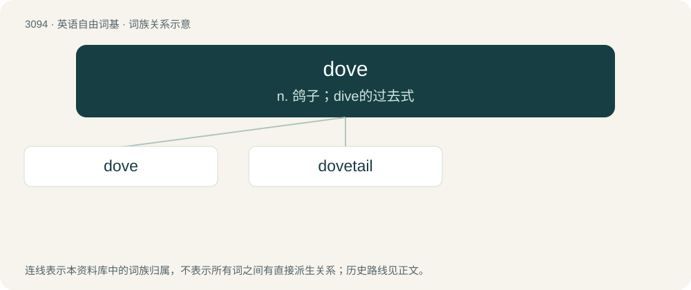

# 3191 · dove — n. 鸽子；dive的过去式

[总目录](../00_总目录_按常用程度.md)

**类型**：英语自由词基　｜　**来源语言**：见词源记录

## 核心含义与来源

- 核心含义：n. 鸽子；dive的过去式
- 英文含义：A pigeon, especially one smaller in size and white-colored; a bird (often arbitrarily called either a pigeon or a dove or both) of more than three hundred species of the family Columbidae.
- 词形：dove

**来源记录 1**（名词；A pigeon, especially one smaller in size and white-colored; a bird (often arbitrarily called either a pigeon or a dove or both) of more than three hundred species of the family Columbidae.）

From Middle English douve, dove, duve, from Old English \*dūfe (“dove, pigeon”), from Proto-West Germanic \*dūbā, from Proto-Germanic \*dūbǭ (“dove, pigeon”). Cognate with Scots doo, dow, Saterland Frisian Duuwe, West Frisian do, Dutch duif, Afrikaans duif, Sranan Tongo doifi, German Taube, German Low German Duuv, Dutch Low Saxon duve, doeve, Danish due, Faroese dúgva, Icelandic dúfa, Norwegian Bokmål due, Norwegian Nynorsk due, Swedish duva, Yiddish טויב (toyb), Gothic \*𐌳𐌿𐌱𐍉 (\*dubō).

## 词族图

## 单词速览（常用到不常用）

| 单词 | 音标 | 释义 |
|---|---|---|
| [dove](#w-1) | /dʌv/ | n. 鸽子；dive的过去式 |
| [dovetail](#w-2) | 英 /ˈdʌvteɪl/；美 /ˈdʌvˌteɪl/ | n. 楔形榫头；vt. 与...吻合, 用鸠尾榫接合；vi. 吻合 |

## 逐词详解

### 1. dove

**词性**：名词　｜　**音标**：/dʌv/

**中文释义**：n. 鸽子；dive的过去式

**英文义项**：A pigeon, especially one smaller in size and white-colored; a bird (often arbitrarily called either a pigeon or a dove or both) of more than three hundred species of the family Columbidae. / A person favouring conciliation and negotiation rather than conflict.

**词源与演化**：

From Middle English douve, dove, duve, from Old English \*dūfe (“dove, pigeon”), from Proto-West Germanic \*dūbā, from Proto-Germanic \*dūbǭ (“dove, pigeon”). Cognate with Scots doo, dow, Saterland Frisian Duuwe, West Frisian do, Dutch duif, Afrikaans duif, Sranan Tongo doifi, German Taube, German Low German Duuv, Dutch Low Saxon duve, doeve, Danish due, Faroese dúgva, Icelandic dúfa, Norwegian Bokmål due, Norwegian Nynorsk due, Swedish duva, Yiddish טויב (toyb), Gothic \*𐌳𐌿𐌱𐍉 (\*dubō).

**例句**：

> Tom yelled something in French just before he dove into the water.

### 2. dovetail

**词性**：动词　｜　**音标**：英 /ˈdʌvteɪl/；美 /ˈdʌvˌteɪl/

**中文释义**：n. 楔形榫头；vt. 与...吻合, 用鸠尾榫接合；vi. 吻合

**英文义项**：To unite (components) with a dovetail (noun sense 2.1) or similar joint. / To combine or fit (things) together well.

**构词拆分**：dove + tail

**词源与演化**：

The noun is derived from dove + tail. The verb is derived from the noun.

**例句**：

> The executive board dovetailed its decision neatly with the prior projects the company had taken up.

该用例对应义项：To combine or fit (things) together well.
