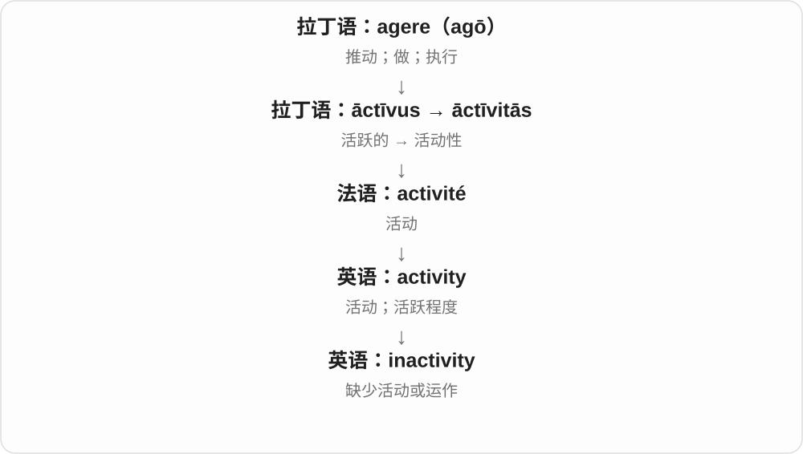
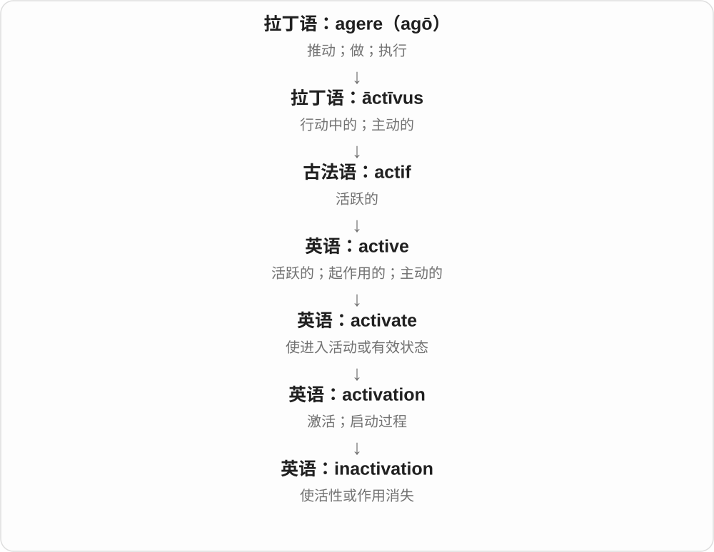

# 3192 · inactive — 活动状态被否定，再分闲置与使失活过程

[逐词精讲目录](../00_逐词精讲目录.md) · [总目录](../00_总目录_按常用程度.md)

## 核心词根与来源

账号、设备、物质、人物可以在各自语境中不活跃。词先说状态，原因与是否能恢复由上下文决定。

**INACTIVE：眼下没有活动、起作用，不必永远坏掉**

inactive → inactivity；inactivate → inactivation，状态与造成状态的动作分开。

- **不活跃性质及状态**：inactive · inactivity
- **使不活跃的动作和过程**：inactivate · inactivation

## 词形与演化规律

in- 否定 + active；-ity 状态；-ate 使进入状态；-ation 动作、过程。

## 单词速览（按词族由简到繁）

同一基础词的相关扩展放在一起，先读基础形式，再读扩展；各组之间优先读常用的。具体词源关系见各词讲解。

| 单词 | 音标 | 核心意思 |
|---|---|---|
| [inactive](#w-1) | /ɪnˈæktɪv/ | 不活跃的；未启用的；不起作用的 |
| [inactivity](#w-2) | /ˌɪnækˈtɪvəti/ | 不活动；闲置；停滞状态 |
| [inactivation](#w-3) | /ɪnˌæktɪˈveɪʃən/ | 失活；使不再起作用的过程 |
| [inactivate](#w-4) | /ɪˈnæktɪveɪt/ | 使失去活性；使不起作用 |

## 逐词讲解

### 1. inactive — 不活跃的；未启用的；不起作用的

**音标**：/ɪnˈæktɪv/

**先抓住这个画面**

没有在行动、没有正在发挥作用，可能只是暂时停着。

**怎么拆**

in- 不 + active 活跃、起作用的；否定的是活动状态，不自动等于永远损坏。

**怎么变成今天的意思**

**拉丁语 agere → āctus、āctīvus → 法语 actif**  
做、行动 → 行动、积极活动的

↓

**英语 active 及其后续构词**  
活跃、起作用；使启动；相应方式、人物与活动

↓

**in- + active → inactive**  
不活跃、未起作用的

an inactive account 不活跃或未启用的账号，an inactive member 不活跃成员；inactive ingredients 非活性成分是特定产品语境。

**常见搭配与例句**

remain inactive；an inactive account；an inactive member。

> The club reviewed its list of inactive members.

俱乐部核对了不活跃会员名单。

> The old account has been inactive for several years.

旧账号已多年没有活动。

**别混淆**

inactive 不自动等于 broken 损坏；系统、协会怎样定义不活跃，要看具体规则。

### 2. inactivity — 不活动；闲置；停滞状态

**音标**：/ˌɪnækˈtɪvəti/

**先抓住这个画面**

inactivity 像一台很久没开机的机器，或一天几乎没怎么活动的身体。

**怎么拆**

in-（不）+ activity，也可从 inactive 对应到 -ity 名词。

**怎么变成今天的意思**

常描述系统闲置、身体活动少或业务没有动静。通常比 inaction 少一些“该处理却没处理”的指责。

**常见搭配与例句**

physical inactivity；a period of inactivity；account inactivity。

> The screen locks after ten minutes of inactivity.

十分钟没有操作后，屏幕会锁定。

> After a period of inactivity, the workshop reopened.

停工一段时间后，作坊重新开门了。

**别混淆**

inactivity 是活动少或没有活动；inaction 常专指面对事情没有采取措施。

### 3. inactivation — 失活；使不再起作用的过程

**音标**：/ɪnˌæktɪˈveɪʃən/

**先抓住这个画面**

inactivation 像把能发挥作用的东西变成不起作用，研究中常关注功能是否消失。

**怎么拆**

in-（不）+ activation，或 inactive + -ation。

**怎么变成今天的意思**

常见于实验、酶与生物学描述；它说的是功能失去，不一定意味着物体被移走或完全毁坏。

**常见搭配与例句**

enzyme inactivation；gene inactivation；a process of inactivation。

> The experiment measured enzyme inactivation over time.

实验测量了酶随时间失活的情况。

> The researchers compared two methods of inactivation.

研究人员比较了两种使其失活的方法。

**别混淆**

deactivation 更常见于设备、账号等停用；inactivation 在生物化学里更常用，二者有重叠。

### 4. inactivate — 使失去活性；使不起作用

**音标**：/ɪˈnæktɪveɪt/

**先抓住这个画面**

东西可能还在那里，却不再发挥原来的作用。inactivate 突出把它变成无活性、无效的状态。

**怎么拆**

可分析为 inactive + -ate，或否定前缀 in- + activate；两种分析都指向使不活跃、使失去作用。

**怎么变成今天的意思**

**拉丁 actīvus → active**  
能行动、起作用的

↓

**inactive + -ate／in- + activate**  
使成为不活动、无活性的状态

inactivate an enzyme 使酶失活，inactivate a protein 使蛋白质失去活性。常见于技术、生物化学描述。

**常见搭配与例句**

inactivate an enzyme；be inactivated。

> The treatment inactivated the enzyme.

这种处理使酶失去了活性。

> The report explains how the protein becomes inactivated.

报告解释了这种蛋白质如何失去活性。

**别混淆**

inactivate 与 deactivate 有重叠；前者很常突出活性丧失，后者也常说停用设备、账号。不要把它们规定成绝对不能重叠的两类。

## 这一组要分清什么

inactive 不等于所有东西 permanently broken 永久损坏；inactivity 是状态，inactivation 强调使成该状态的过程。

## 串起来练习

The account remained inactive after its inactivation.

账号停用后一直处于不活跃状态。
