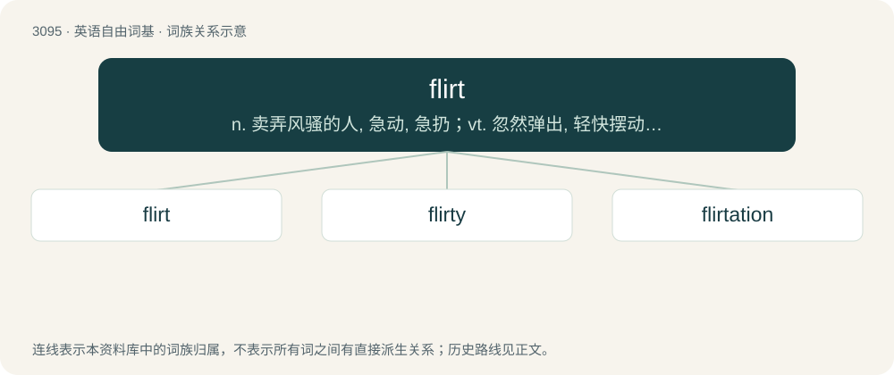

# 3193 · flirt — n. 卖弄风骚的人, 急动, 急扔；vt. 忽然弹出, 轻快摆动, 挥动；vi. 调情, 玩弄, 摆动, 轻率地对待

[总目录](../00_总目录_按常用程度.md)

**类型**：英语自由词基　｜　**来源语言**：见词源记录

## 核心含义与来源

- 核心含义：n. 卖弄风骚的人, 急动, 急扔；vt. 忽然弹出, 轻快摆动, 挥动；vi. 调情, 玩弄, 摆动, 轻率地对待
- 英文含义：A sudden jerk; a quick throw or cast; a darting motion
- 词形：flirt

**来源记录 1**（名词；A sudden jerk; a quick throw or cast; a darting motion）

1553, from the merger of Early Modern English flirt (“to flick”), flurt (“to mock, jibe, scorn”), and flirt, flurt (“a giddy girl”). Of obscure origin and relation. Apparently related to similar words in Germanic, all of apparently onomatopoeic origin, compare Low German flirt (“a flick of the fingers, a light blow”), Low German flirtje (“a giddy girl”), Low German flirtje (“a flirt”), German Flittchen (“a flirt; tart; hussy”), Norwegian flira (“to giggle, titter”). Compare also Early Modern English jillflirt, gillian flirt, and flirt-gill (“a flirt”), and Scots flird (“a trifling", also, "to jibe, jeer at, talk idly, flirt, flaunt”), which is perhaps from Middle English flerd (“mockery, fraud, deception”), from Old English fleard (“nonsense, vanity, folly, deception”); potentially related to Icelandic flærð (“trickiness, deceit”), Swedish flärd (“vanity, frivolity, flamboyance”), Dutch flard (“tatter, shred”). See flird.

## 词族图

## 单词速览（常用到不常用）

| 单词 | 音标 | 释义 |
|---|---|---|
| [flirt](#w-1) | 英 /flɜːt/；美 /flɚt/ | n. 卖弄风骚的人, 急动, 急扔；vt. 忽然弹出, 轻快摆动, 挥动；vi. 调情, 玩弄, 摆动, 轻率地对待 |
| [flirty](#w-2) | 英 /ˈflɜːti/；美 /ˈflɜɹti/ | a. 轻浮的 |
| [flirtation](#w-3) | 英 /fləˈteɪʃn̩/；美 /flɚˈteɪʃn̩/ | n. 调情, 挑逗, 调戏, 不认真的考虑 |

## 逐词详解

### 1. flirt

**词性**：动词　｜　**音标**：英 /flɜːt/；美 /flɚt/

**中文释义**：n. 卖弄风骚的人, 急动, 急扔；vt. 忽然弹出, 轻快摆动, 挥动；vi. 调情, 玩弄, 摆动, 轻率地对待

**英文义项**：To throw (something) with a jerk or sudden movement; to fling. / To dart about; to move with quick, jerky motions.

**词源与演化**：

1553, from the merger of Early Modern English flirt (“to flick”), flurt (“to mock, jibe, scorn”), and flirt, flurt (“a giddy girl”). Of obscure origin and relation. Apparently related to similar words in Germanic, all of apparently onomatopoeic origin, compare Low German flirt (“a flick of the fingers, a light blow”), Low German flirtje (“a giddy girl”), Low German flirtje (“a flirt”), German Flittchen (“a flirt; tart; hussy”), Norwegian flira (“to giggle, titter”). Compare also Early Modern English jillflirt, gillian flirt, and flirt-gill (“a flirt”), and Scots flird (“a trifling", also, "to jibe, jeer at, talk idly, flirt, flaunt”), which is perhaps from Middle English flerd (“mockery, fraud, deception”), from Old English fleard (“nonsense, vanity, folly, deception”); potentially related to Icelandic flærð (“trickiness, deceit”), Swedish flärd (“vanity, frivolity, flamboyance”), Dutch flard (“tatter, shred”). See flird.

**例句**：

> They flirt water in each other's faces.

该用例对应义项：To throw (something) with a jerk or sudden movement; to fling.

### 2. flirty

**词性**：形容词　｜　**音标**：英 /ˈflɜːti/；美 /ˈflɜɹti/

**中文释义**：a. 轻浮的

**英文义项**：Flirting, or seeming to flirt.

**构词拆分**：flirt + -y

**词源与演化**：

From flirt + -y.

**例句**：

> Despite being married, Yanni was always very flirty with his female co-workers.

### 3. flirtation

**词性**：名词　｜　**音标**：英 /fləˈteɪʃn̩/；美 /flɚˈteɪʃn̩/

**中文释义**：n. 调情, 挑逗, 调戏, 不认真的考虑

**英文义项**：Playing at courtship; coquetry. / An instance of flirting.

**构词拆分**：flirt + -ation

**词源与演化**：

From flirt + -ation.

**例句**：

> Aside from a brief flirtation with belly dancing, Mary decided she would rather kick-box.
