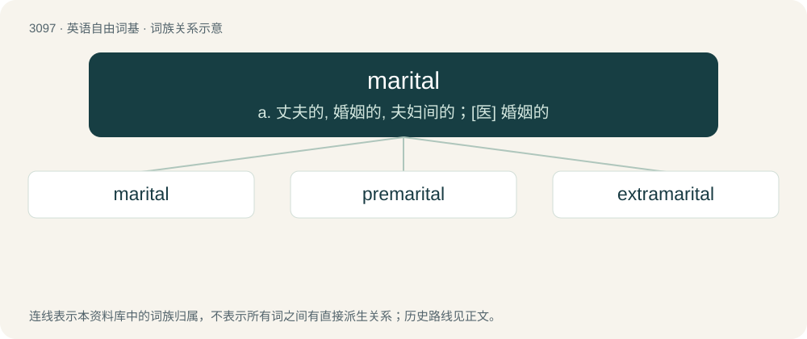

# 3195 · marital — a. 丈夫的, 婚姻的, 夫妇间的；\[医\] 婚姻的

[总目录](../00_总目录_按常用程度.md)

**类型**：英语自由词基　｜　**来源语言**：见词源记录

## 核心含义与来源

- 核心含义：a. 丈夫的, 婚姻的, 夫妇间的；\[医\] 婚姻的
- 英文含义：Pertaining to marriage.
- 词形：marital

**来源记录 1**（形容词；Pertaining to marriage.）

Borrowed from Middle French marital, and its source, Latin marītālis, from marītus (“husband”).

## 词族图

## 单词速览（常用到不常用）

| 单词 | 音标 | 释义 |
|---|---|---|
| [marital](#w-1) | /ˈmæɹɪtəl/ | a. 丈夫的, 婚姻的, 夫妇间的；\[医\] 婚姻的 |
| [premarital](#w-2) | /priːˈmæritl/ | a. 婚前的 |
| [extramarital](#w-3) | /ˌɛkstɹəˈmæɹɪtəl/ | a. 婚外的；\[法\] 私通的, 通奸的 |

## 逐词详解

### 1. marital

**词性**：形容词　｜　**音标**：/ˈmæɹɪtəl/

**中文释义**：a. 丈夫的, 婚姻的, 夫妇间的；\[医\] 婚姻的

**英文义项**：Pertaining to marriage.

**词源与演化**：

Borrowed from Middle French marital, and its source, Latin marītālis, from marītus (“husband”).

**例句**：

> They sought counseling for their marital problems.

该用例对应义项：Pertaining to marriage.

### 2. premarital

**词性**：形容词　｜　**音标**：/priːˈmæritl/

**中文释义**：a. 婚前的

**英文义项**：Before marriage; before getting married.

**构词拆分**：pre- + marital

**词源与演化**：

From pre- + marital.

**例句**：

> Premarital sex is now far more common than it was in the 1920s.

该用例对应义项：Before marriage; before getting married.

### 3. extramarital

**词性**：形容词　｜　**音标**：/ˌɛkstɹəˈmæɹɪtəl/

**中文释义**：a. 婚外的；\[法\] 私通的, 通奸的

**英文义项**：Occurring outside marriage. / Adulterous.

**构词拆分**：extra- + marital

**词源与演化**：

From extra- + marital.

**例句**：

> I would be surprised if Tom had never had any extramarital affairs.
