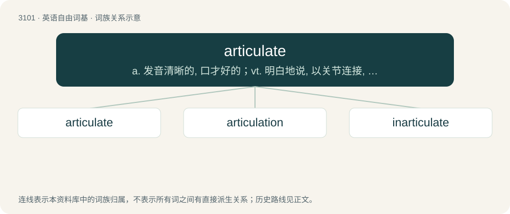

# 3197 · articulate — a. 发音清晰的, 口才好的；vt. 明白地说, 以关节连接, 使成为系统的整体

[总目录](../00_总目录_按常用程度.md)

**类型**：英语自由词基　｜　**来源语言**：见词源记录

## 核心含义与来源

- 核心含义：a. 发音清晰的, 口才好的；vt. 明白地说, 以关节连接, 使成为系统的整体
- 英文含义：To make clear or effective.
- 词形：articulate

**来源记录 1**（动词；To make clear or effective.）

The adjective is first attested in 1531, the verb in 1551; borrowed from Latin articulātus (“distinct, articulated, jointed”), perfect passive participle of articulō, see -ate (etymology 1, 2 and 3). Regular participial usage of the adjective up until Early Modern English.

## 词族图

## 单词速览（常用到不常用）

| 单词 | 音标 | 释义 |
|---|---|---|
| [articulate](#w-1) | 英 /ɑː(ɹ)ˈtɪk.jʊ.leɪt/；美 /ɑːɹˈtɪk.jə.leɪt/ | a. 发音清晰的, 口才好的；vt. 明白地说, 以关节连接, 使成为系统的整体 |
| [articulation](#w-2) | 英 /ɑːˌtɪk.jʊˈleɪ.ʃən/；美 /ɑɹˌtɪk.jəˈleɪ.ʃən/ | n. 关节, 接合, 连贯, 发音, 表达；\[计\] 清晰度 |
| [inarticulate](#w-3) | 英 /ɪn.ɑːˈtɪk.jʊ.lət/；美 /ɪn.ɑɹˈtɪk.jə.lət/ | a. 口齿不清的, 说不出的, 难于言喻的；\[医\] 无关节的, 无音节的(语言) |

## 逐词详解

### 1. articulate

**词性**：动词　｜　**音标**：英 /ɑː(ɹ)ˈtɪk.jʊ.leɪt/；美 /ɑːɹˈtɪk.jə.leɪt/

**中文释义**：a. 发音清晰的, 口才好的；vt. 明白地说, 以关节连接, 使成为系统的整体

**英文义项**：To make clear or effective. / To speak clearly; to enunciate.

**词源与演化**：

The adjective is first attested in 1531, the verb in 1551; borrowed from Latin articulātus (“distinct, articulated, jointed”), perfect passive participle of articulō, see -ate (etymology 1, 2 and 3). Regular participial usage of the adjective up until Early Modern English.

**例句**：

> The lower jaw articulates with the skull at the temporomandibular joint.

该用例对应义项：To form a joint or connect by joints.

### 2. articulation

**词性**：名词　｜　**音标**：英 /ɑːˌtɪk.jʊˈleɪ.ʃən/；美 /ɑɹˌtɪk.jəˈleɪ.ʃən/

**中文释义**：n. 关节, 接合, 连贯, 发音, 表达；\[计\] 清晰度

**英文义项**：A joint or the collection of joints at which something is articulated, or hinged, for bending. / Such a joint in an animalian body, as for example between bones or between exoskeleton segments.

**构词拆分**：articulate + -ion

**词源与演化**：

From Middle English articulacioun, from Old French articulacion, from Medieval Latin articulatio. Equivalent to articulate + -ion.

**例句**：

> The articulation in this piece is tricky because it alternates between legato and staccato.

该用例对应义项：The manner in which a note is attacked.

### 3. inarticulate

**词性**：形容词　｜　**音标**：英 /ɪn.ɑːˈtɪk.jʊ.lət/；美 /ɪn.ɑɹˈtɪk.jə.lət/

**中文释义**：a. 口齿不清的, 说不出的, 难于言喻的；\[医\] 无关节的, 无音节的(语言)

**英文义项**：Not articulated in normal words. / Speechless.

**构词拆分**：in- + articulate

**词源与演化**：

From Latin inarticulatus and from in- + articulate. See -ate (adjective-forming suffix).

**例句**：

> Remained stupidly inarticulate and saying something noncommittal.

该用例对应义项：without or deprived of the use of speech or words
