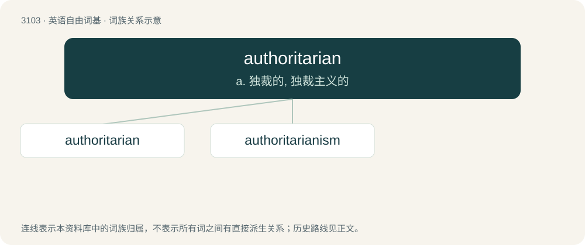

# 3199 · authoritarian — a. 独裁的, 独裁主义的

[总目录](../00_总目录_按常用程度.md)

**类型**：英语自由词基　｜　**来源语言**：见词源记录

## 核心含义与来源

- 核心含义：a. 独裁的, 独裁主义的
- 英文含义：Of, or relating to, or exhibiting strict obedience to an authority; favoring authoritarianism over civic and individual liberties.
- 词形：authoritarian

**来源记录 1**（形容词；Of, or relating to, or exhibiting strict obedience to an authority; favoring authoritarianism over civic and individual liberties.）

From authority + -arian, circa 1880.

## 词族图

## 单词速览（常用到不常用）

| 单词 | 音标 | 释义 |
|---|---|---|
| [authoritarian](#w-1) | 英 /ɔːˌθɒɹ.ɪˈtɛə̯.ɹɪən/；美 /əˌθɔɹ.əˈtɛɹ.i.ən/ | a. 独裁的, 独裁主义的 |
| [authoritarianism](#w-2) | 美 /ɔˌθɔːɹɪˈtɛːɹiən.ɪzm̩/ | n. 独裁主义；权力主义 |

## 逐词详解

### 1. authoritarian

**词性**：形容词　｜　**音标**：英 /ɔːˌθɒɹ.ɪˈtɛə̯.ɹɪən/；美 /əˌθɔɹ.əˈtɛɹ.i.ən/

**中文释义**：a. 独裁的, 独裁主义的

**英文义项**：Of, or relating to, or exhibiting strict obedience to an authority; favoring authoritarianism over civic and individual liberties. / Demanding obedience to authority; marked by authoritarianism; dictatorial, tyrannical.

**构词拆分**：authority + -arian

**词源与演化**：

From authority + -arian, circa 1880.

**例句**：

> The authoritarian government was demanding stricter laws for low-wage peasants.

该用例对应义项：Demanding obedience to authority; marked by authoritarianism; dictatorial, tyrannical.

### 2. authoritarianism

**词性**：名词　｜　**音标**：美 /ɔˌθɔːɹɪˈtɛːɹiən.ɪzm̩/

**中文释义**：n. 独裁主义；权力主义

**英文义项**：A form of government in which the governing body has absolute, or almost absolute, control. Typically this control is maintained by force, and little heed is paid to public opinion or the judicial system.

**构词拆分**：authoritarian + -ism

**词源与演化**：

From authoritarian + -ism.

**例句**：

> There appears to be growing contest between authoritarianism and liberalism right now.
