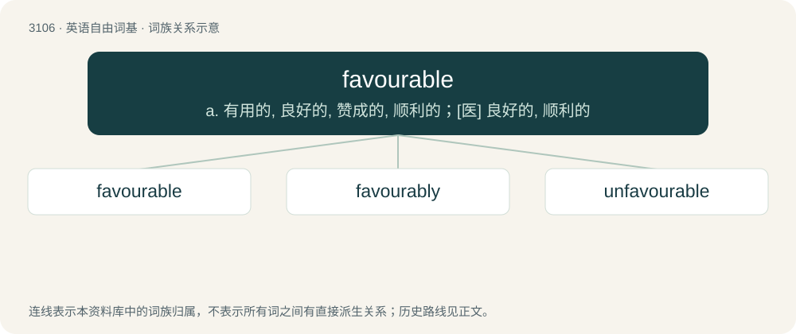

# 3202 · favourable — a. 有用的, 良好的, 赞成的, 顺利的；\[医\] 良好的, 顺利的

[总目录](../00_总目录_按常用程度.md)

**类型**：英语自由词基　｜　**来源语言**：见词源记录

## 核心含义与来源

- 核心含义：a. 有用的, 良好的, 赞成的, 顺利的；\[医\] 良好的, 顺利的
- 英文含义：Apt to win favour; pleasing.
- 词形：favourable

**来源记录 1**（形容词；Apt to win favour; pleasing.）

From Middle English favourable, from Old French favorable, from Latin favōrābilis, from favor. By surface analysis, favour + -able.

## 词族图

## 单词速览（常用到不常用）

| 单词 | 音标 | 释义 |
|---|---|---|
| [favourable](#w-1) | /ˈfeɪv(ə)ɹəbəl/ | a. 有用的, 良好的, 赞成的, 顺利的；\[医\] 良好的, 顺利的 |
| [favourably](#w-2) |  | adv. 顺利地；有利地；好意地（等于favorably） |
| [unfavourable](#w-3) |  | a. 不适宜的, 不适应的, 不顺利的, 不好的, 相反的, 不同意的, 令人不快的 |

## 逐词详解

### 1. favourable

**词性**：形容词　｜　**音标**：/ˈfeɪv(ə)ɹəbəl/

**中文释义**：a. 有用的, 良好的, 赞成的, 顺利的；\[医\] 良好的, 顺利的

**英文义项**：Apt to win favour; pleasing. / Expressing or indicating favour or goodwill; approving, encouraging.

**词源与演化**：

From Middle English favourable, from Old French favorable, from Latin favōrābilis, from favor. By surface analysis, favour + -able.

**例句**：

> The candidate wearing the business suit made a favourable impression.

该用例对应义项：Apt to win favour; pleasing.

### 2. favourably

**词性**：副词

**中文释义**：adv. 顺利地；有利地；好意地（等于favorably）

**英文义项**：In a favourable manner.

**构词拆分**：favourable + -ly

**词源与演化**：

From favourable + -ly.

**例句**：

> She looked favourably on people who gave freely their assistance.

该用例对应义项：In a favourable manner.

### 3. unfavourable

**词性**：形容词

**中文释义**：a. 不适宜的, 不适应的, 不顺利的, 不好的, 相反的, 不同意的, 令人不快的

**英文义项**：Serving to hinder or oppose; adverse, disadvantageous, inconducive, unsuitable. / Not auspicious; ill-boding.

**构词拆分**：un- + favourable

**词源与演化**：

From un- + favourable.

**例句**：

> I made it plain that the situation was unfavourable to us.
