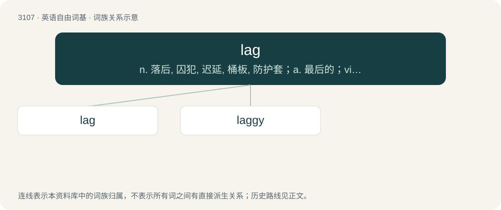

# 3203 · lag — n. 落后, 囚犯, 迟延, 桶板, 防护套；a. 最后的；vi. 落后, 蹒跚, 缓缓而行, 滞后

[总目录](../00_总目录_按常用程度.md)

**类型**：英语自由词基　｜　**来源语言**：见词源记录

## 核心含义与来源

- 核心含义：n. 落后, 囚犯, 迟延, 桶板, 防护套；a. 最后的；vi. 落后, 蹒跚, 缓缓而行, 滞后
- 英文含义：Late.
- 词形：lag

**来源记录 1**（形容词；Late.）

Of unknown origin. Possibly of North Germanic origin.

## 词族图

## 单词速览（常用到不常用）

| 单词 | 音标 | 释义 |
|---|---|---|
| [lag](#w-1) | 英 /læɡ/；/leɪɡ/ | n. 落后, 囚犯, 迟延, 桶板, 防护套；a. 最后的；vi. 落后, 蹒跚, 缓缓而行, 滞后 |
| [laggy](#w-2) | /ˈlæɡi/ | 【英文】Having a delayed response to a change in the factors influencing it. |

## 逐词详解

### 1. lag

**词性**：动词　｜　**音标**：英 /læɡ/；/leɪɡ/

**中文释义**：n. 落后, 囚犯, 迟延, 桶板, 防护套；a. 最后的；vi. 落后, 蹒跚, 缓缓而行, 滞后

**英文义项**：To fail to keep up (the pace), to fall behind. / To cover (for example, pipes) with felt strips or similar material.

**词源与演化**：

Of unknown origin. Possibly of North Germanic origin.

**例句**：

> Interest in the scandal will never lag.

该用例对应义项：To slacken

### 2. laggy

**词性**：形容词　｜　**音标**：/ˈlæɡi/

**英文义项**：Having a delayed response to a change in the factors influencing it. / Tending to lag, or respond slowly because of network latency.

**构词拆分**：lag + -y

**词源与演化**：

From lag + -y.

**例句**：

> I've given up trying to play on that laggy server.

该用例对应义项：Tending to lag, or respond slowly because of network latency.
