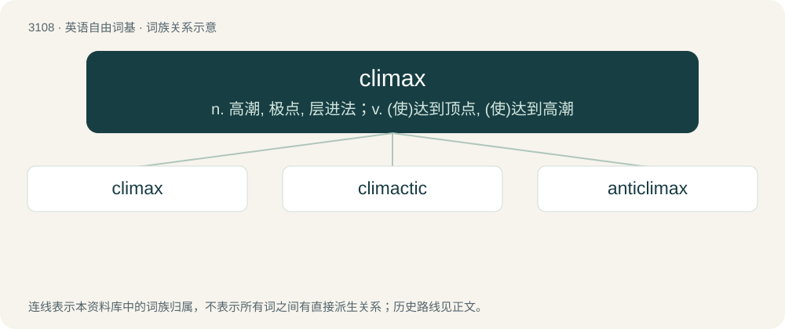

# 3205 · climax — n. 高潮, 极点, 层进法；v. (使)达到顶点, (使)达到高潮

[总目录](../00_总目录_按常用程度.md)

**类型**：英语自由词基　｜　**来源语言**：见词源记录

## 核心含义与来源

- 核心含义：n. 高潮, 极点, 层进法；v. (使)达到顶点, (使)达到高潮
- 英文含义：A rhetorical device in which a series is arranged in ascending order.
- 词形：climax

**来源记录 1**（名词；A rhetorical device in which a series is arranged in ascending order.）

From Latin clīmax, from Ancient Greek κλῖμαξ (klîmax, “ladder, staircase, \[rhetorical\] climax”), from κλίνω (klínō, “to lean, slant”).

## 词族图

## 单词速览（常用到不常用）

| 单词 | 音标 | 释义 |
|---|---|---|
| [climax](#w-1) | /ˈklaɪ.mæks/ | n. 高潮, 极点, 层进法；v. (使)达到顶点, (使)达到高潮 |
| [climactic](#w-2) | /ˌklaɪˈmæk.tɪk/ | a. 顶点的, 高潮的 |
| [anticlimax](#w-3) | 美 /ˈæn.tiˌklaɪ.mæks/ | n. 突降法, 虎头蛇尾 |

## 逐词详解

### 1. climax

**词性**：名词　｜　**音标**：/ˈklaɪ.mæks/

**中文释义**：n. 高潮, 极点, 层进法；v. (使)达到顶点, (使)达到高潮

**英文义项**：A rhetorical device in which a series is arranged in ascending order. / The culmination of a narrative's rising action, the turning point.

**词源与演化**：

From Latin clīmax, from Ancient Greek κλῖμαξ (klîmax, “ladder, staircase, \[rhetorical\] climax”), from κλίνω (klínō, “to lean, slant”).

**例句**：

> The climax of the artist's career.

该用例对应义项：the highest point of anything conceived of as growing or developing or unfolding

### 2. climactic

**词性**：形容词　｜　**音标**：/ˌklaɪˈmæk.tɪk/

**中文释义**：a. 顶点的, 高潮的

**英文义项**：Of, pertaining to, or constituting a climax; reaching a decisive moment or point of greatest excitement.

**构词拆分**：climax + -ic

**词源与演化**：

From climax + -ic on analogy of syntactic.

**例句**：

> The race ended in a climactic, neck-and-neck scramble for the finish line.

该用例对应义项：Of, pertaining to, or constituting a climax; reaching a decisive moment or point of greatest excitement.

### 3. anticlimax

**词性**：名词　｜　**音标**：美 /ˈæn.tiˌklaɪ.mæks/

**中文释义**：n. 突降法, 虎头蛇尾

**英文义项**：A failed or reverse climax, particularly / An unsatisfying resolution to a narrative, usually owing to a deus ex machina or similarly trivial resolution of the main conflict.

**构词拆分**：anti- + climax

**词源与演化**：

From anti- + climax.

**例句**：

> This is more like an anticlimax.
