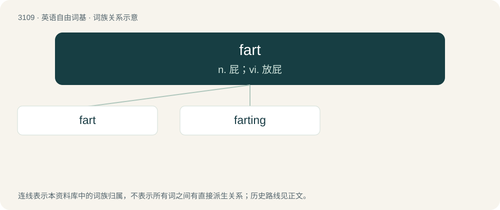

# 3206 · fart — n. 屁；vi. 放屁

[总目录](../00_总目录_按常用程度.md)

**类型**：英语自由词基　｜　**来源语言**：见词源记录

## 核心含义与来源

- 核心含义：n. 屁；vi. 放屁
- 英文含义：To emit digestive gases from the anus; to flatulate.
- 词形：fart

**来源记录 1**（动词；To emit digestive gases from the anus; to flatulate.）

From Middle English ferten, farten, from Old English \*feortan, from Proto-West Germanic \*fertan, from Proto-Germanic \*fertaną, from Proto-Indo-European \*perd-. The noun is from Middle English fert, fart, from the verb.

## 词族图

## 单词速览（常用到不常用）

| 单词 | 音标 | 释义 |
|---|---|---|
| [fart](#w-1) | 英 /fɑːt/；美 /fɑɹt/ | n. 屁；vi. 放屁 |
| [farting](#w-2) | 英 /ˈfɑːtɪŋ/；美 /ˈfɑɹtɪŋ/ | v. &lt;讳&gt;放屁( fart的现在分词 ) |

## 逐词详解

### 1. fart

**词性**：名词　｜　**音标**：英 /fɑːt/；美 /fɑɹt/

**中文释义**：n. 屁；vi. 放屁

**英文义项**：An emission of digestive gases from the anus; a flatus. / An irritating person; a fool.

**词源与演化**：

From Middle English ferten, farten, from Old English \*feortan, from Proto-West Germanic \*fertan, from Proto-Germanic \*fertaną, from Proto-Indo-European \*perd-. The noun is from Middle English fert, fart, from the verb.

**例句**：

> I think I heard a fart. Was it you, Nigella?

该用例对应义项：An emission of digestive gases from the anus; a flatus.

### 2. farting

**词性**：名词　｜　**音标**：英 /ˈfɑːtɪŋ/；美 /ˈfɑɹtɪŋ/

**中文释义**：v. &lt;讳&gt;放屁( fart的现在分词 )

**英文义项**：The act of one who farts; a sound like a fart.

**构词拆分**：fart + -ing

**词源与演化**：

From Middle English fartynge, fartyng, ferting, from Old English feorting (“farting”), equivalent to fart + -ing.

**例句**：

> Go to the bathroom instead of farting here next to me.
