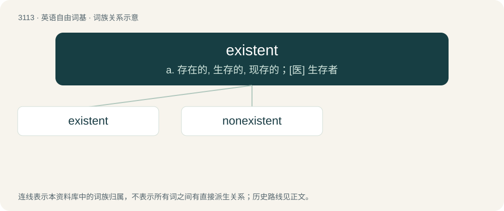

# 3209 · existent — a. 存在的, 生存的, 现存的；\[医\] 生存者

[总目录](../00_总目录_按常用程度.md)

**类型**：英语自由词基　｜　**来源语言**：见词源记录

## 核心含义与来源

- 核心含义：a. 存在的, 生存的, 现存的；\[医\] 生存者
- 英文含义：existing; having life or being, current; occurring now
- 词形：existent

**来源记录 1**（形容词；existing; having life or being, current; occurring now）

From Latin existens, from existere. By surface analysis, exist + -ent.

## 词族图

## 单词速览（常用到不常用）

| 单词 | 音标 | 释义 |
|---|---|---|
| [existent](#w-1) | /ɪɡˈzɪst(ə)nt/ | a. 存在的, 生存的, 现存的；\[医\] 生存者 |
| [nonexistent](#w-2) | /.nɒnigˈzistənt/ | a. 不存在的 |

## 逐词详解

### 1. existent

**词性**：形容词　｜　**音标**：/ɪɡˈzɪst(ə)nt/

**中文释义**：a. 存在的, 生存的, 现存的；\[医\] 生存者

**英文义项**：existing; having life or being, current; occurring now

**词源与演化**：

From Latin existens, from existere. By surface analysis, exist + -ent.

**例句**：

> An attempt to refine the existent machinery to make it more efficient.

该用例对应义项：having existence or being or actuality

### 2. nonexistent

**词性**：形容词　｜　**音标**：/.nɒnigˈzistənt/

**中文释义**：a. 不存在的

**英文义项**：Not existent or existing; not real. / Not present or occurring.

**构词拆分**：non- + existent

**词源与演化**：

From non- + existent.

**例句**：

> His social skills are nonexistent: he chewed with his mouth open all through dinner.

该用例对应义项：Not existent or existing; not real.
