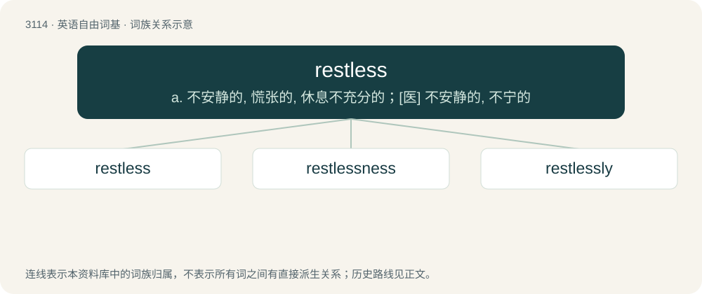

# 3210 · restless — a. 不安静的, 慌张的, 休息不充分的；\[医\] 不安静的, 不宁的

[总目录](../00_总目录_按常用程度.md)

**类型**：英语自由词基　｜　**来源语言**：见词源记录

## 核心含义与来源

- 核心含义：a. 不安静的, 慌张的, 休息不充分的；\[医\] 不安静的, 不宁的
- 英文含义：Not allowing or affording rest.
- 词形：restless

**来源记录 1**（形容词；Not allowing or affording rest.）

From Middle English restles, restelees, from Old English ræstlēas, equivalent to rest + -less.

## 词族图

## 单词速览（常用到不常用）

| 单词 | 音标 | 释义 |
|---|---|---|
| [restless](#w-1) | /ˈɹɛstlɪs/ | a. 不安静的, 慌张的, 休息不充分的；\[医\] 不安静的, 不宁的 |
| [restlessness](#w-2) | /ˈɹɛstləsnəs/ | n. 坐立不安；不安定 |
| [restlessly](#w-3) |  | adv. 不安地；慌张地 |

## 逐词详解

### 1. restless

**词性**：形容词　｜　**音标**：/ˈɹɛstlɪs/

**中文释义**：a. 不安静的, 慌张的, 休息不充分的；\[医\] 不安静的, 不宁的

**英文义项**：Not allowing or affording rest. / Without rest; unable to be still or quiet; uneasy; continually moving.

**构词拆分**：rest + -less

**词源与演化**：

From Middle English restles, restelees, from Old English ræstlēas, equivalent to rest + -less.

**例句**：

> They remained restless, sitting by the window the entire night.

该用例对应义项：Deprived of rest or sleep.

### 2. restlessness

**词性**：名词　｜　**音标**：/ˈɹɛstləsnəs/

**中文释义**：n. 坐立不安；不安定

**英文义项**：The state or condition of being restless; an inability to be still, quiet, at peace or comfortable; a feeling of discomfort with stillness causes by anxiety, boredom or other emotions.

**构词拆分**：restless + -ness

**词源与演化**：

From restless + -ness.

**例句**：

> She sat and fidgeted out of restlessness as she waited.

该用例对应义项：The state or condition of being restless; an inability to be still, quiet, at peace or comfortable; a feeling of discomfort with stillness causes by anxiety, boredom or other emotions.

### 3. restlessly

**词性**：副词

**中文释义**：adv. 不安地；慌张地

**英文义项**：In a restless manner.

**构词拆分**：restless + -ly

**词源与演化**：

From restless + -ly.

**例句**：

> He cracked his knuckles restlessly.

该用例对应义项：in a restless manner
