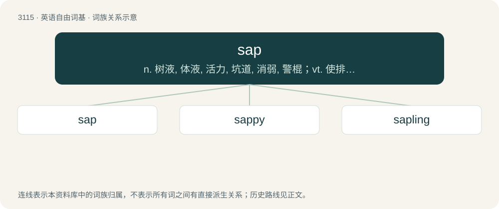

# 3212 · sap — n. 树液, 体液, 活力, 坑道, 消弱, 警棍；vt. 使排出体液, 使伤元气, 使衰竭, 挖坑道逼近, 逐渐侵蚀；vi. 挖坑道, 消弱

[总目录](../00_总目录_按常用程度.md)

**类型**：英语自由词基　｜　**来源语言**：见词源记录

## 核心含义与来源

- 核心含义：n. 树液, 体液, 活力, 坑道, 消弱, 警棍；vt. 使排出体液, 使伤元气, 使衰竭, 挖坑道逼近, 逐渐侵蚀；vi. 挖坑道, 消弱
- 英文含义：The juice of plants of any kind, especially the ascending and descending juices or circulating fluid essential to nutrition.
- 词形：sap

**多个词源／构词路径**：同一拼写可能有不同来源；以下按词性和含义分别列出。

**来源记录 1**（名词；The juice of plants of any kind, especially the ascending and descending juices or circulating fluid essential to nutrition.）

From Middle English sap, from Old English sæp (“juice, sap”), from Proto-West Germanic \*sap (“sap, juice”) (compare Dutch sap, German Saft, Icelandic safi), from Proto-Indo-European \*sab-, \*sap- (“to taste”) (compare Welsh syb-wydd (“fir”), Latin sapa (“must, new wine”), Russian со́пли (sópli, “snivel”), Old Armenian համ (ham, “taste”), Avestan 𐬬𐬌-𐬱𐬁𐬞𐬀 (vi-šāpa, “having poisonous juices”), Sanskrit सबर् (sabar, “juice, nectar”)). More at sage. sap (“naive person”) is a clipping of sapskull (literally “person with sap in their skull”).

**来源记录 2**（动词；To make unstable or infirm; to unsettle; to weaken.）

From French saper (compare Spanish zapar and Italian zappare) from sape (“sort of scythe”), from Late Latin sappa (“sort of mattock”). The sense evolution of from “subvert by digging” to “weaken” was influenced by the sense above “drain wood of sap” as trench warfare receded from public conscience.

**来源记录 3**（名词；A short wooden club; a leather-covered hand weapon; a blackjack.）

Probably from sapling.

## 词族图

## 单词速览（常用到不常用）

| 单词 | 音标 | 释义 |
|---|---|---|
| [sap](#w-1) | /sæp/ | n. 树液, 体液, 活力, 坑道, 消弱, 警棍；vt. 使排出体液, 使伤元气, 使衰竭, 挖坑道逼近, 逐渐侵蚀；vi. 挖坑道, 消弱 |
| [sappy](#w-2) | /ˈsæpi/ | a. 树液多的, 精力充沛的 |
| [sapling](#w-3) | /ˈsæplɪŋ/ | n. 树苗, 小树 |

## 逐词详解

### 1. sap

**词性**：名词　｜　**音标**：/sæp/

**中文释义**：n. 树液, 体液, 活力, 坑道, 消弱, 警棍；vt. 使排出体液, 使伤元气, 使衰竭, 挖坑道逼近, 逐渐侵蚀；vi. 挖坑道, 消弱

**英文义项**：The juice of plants of any kind, especially the ascending and descending juices or circulating fluid essential to nutrition. / The sapwood, or alburnum, of a tree.

**词源与演化**：

From Middle English sap, from Old English sæp (“juice, sap”), from Proto-West Germanic \*sap (“sap, juice”) (compare Dutch sap, German Saft, Icelandic safi), from Proto-Indo-European \*sab-, \*sap- (“to taste”) (compare Welsh syb-wydd (“fir”), Latin sapa (“must, new wine”), Russian со́пли (sópli, “snivel”), Old Armenian համ (ham, “taste”), Avestan 𐬬𐬌-𐬱𐬁𐬞𐬀 (vi-šāpa, “having poisonous juices”), Sanskrit सबर् (sabar, “juice, nectar”)). More at sage. sap (“naive person”) is a clipping of sapskull (literally “person with sap in their skull”).

**例句**：

> Look at the sap mowing our lawn while we pretend our own lawnmower is broken.

该用例对应义项：A naive person; a simpleton.

### 2. sappy

**词性**：形容词　｜　**音标**：/ˈsæpi/

**中文释义**：a. 树液多的, 精力充沛的

**英文义项**：Excessively sweet, emotional, nostalgic; cheesy; mushy. (British equivalent: soppy) / Having (a particularly large amount of) sap.

**构词拆分**：sap + -y

**词源与演化**：

From Middle English sappy, sapy, from Old English sæpiġ (“full of sap, succulent”), equivalent to sap + -y. Cognate with West Frisian sappig (“juicy”), Dutch sappig (“juicy, succulent”), Middle High German saffic, seffec ("juicy, succulent"; &gt; German saftig), Danish saftig (“juicy”), Swedish saftig (“juicy”). Doublet of zaftig.

**例句**：

> It was a sappy love song, but it reminded them of their first dance.

该用例对应义项：Excessively sweet, emotional, nostalgic; cheesy; mushy. (British equivalent: soppy)

### 3. sapling

**词性**：名词　｜　**音标**：/ˈsæplɪŋ/

**中文释义**：n. 树苗, 小树

**英文义项**：A young tree, larger than a seedling. / A youngster, especially a male nearing maturity.

**构词拆分**：sap + -ling

**词源与演化**：

From Middle English saplyng, seplyng, sapling, equivalent to sap + -ling.

**例句**：

> We planted an acer sapling in our garden last spring.
