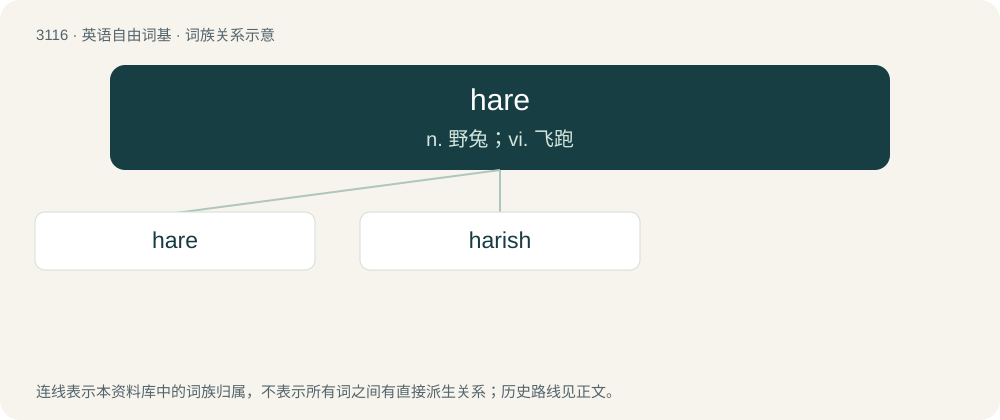

# 3213 · hare — n. 野兔；vi. 飞跑

[总目录](../00_总目录_按常用程度.md)

**类型**：英语自由词基　｜　**来源语言**：见词源记录

## 核心含义与来源

- 核心含义：n. 野兔；vi. 飞跑
- 英文含义：Any of several plant-eating mammals of the genus Lepus, similar to a rabbit, but larger and with longer ears.
- 词形：hare

**多个词源／构词路径**：同一拼写可能有不同来源；以下按词性和含义分别列出。

**来源记录 1**（名词；Any of several plant-eating mammals of the genus Lepus, similar to a rabbit, but larger and with longer ears.）

From Middle English hare, from Old English hara (“hare”), from Proto-West Germanic \*hasō ~ \*haʀ-, from Proto-Germanic \*hesô, from Proto-Indo-European \*ḱh₂s-én-; possibly related to or influenced by Proto-Germanic \*haswaz (“grey”). Cognates See also West Frisian hazze, Dutch haas, German Hase, Norwegian and Swedish hare, Icelandic heri), Old English hasu, Middle High German heswe (“pale, dull”); also Welsh cannu (“to whiten”), ceinach (“hare”), Latin cānus (“white”), cascus (“old”), Old Prussian sasnis (“hare”), Pashto سوی (soe, “hare”) and Sanskrit शश (śaśa, “hare”).

**来源记录 2**（形容词；Grey, hoary; grey-haired, venerable (of people).）

From Middle English hore, from Old English hār (“hoar, hoary, grey, old”), from Proto-Germanic \*hairaz (“grey”). Cognate with German hehr (“noble, sublime”).

## 词族图

## 单词速览（常用到不常用）

| 单词 | 音标 | 释义 |
|---|---|---|
| [hare](#w-1) | 英 /hɛə/；美 /hɛɚ/ | n. 野兔；vi. 飞跑 |
| [harish](#w-2) |  | n. (Harish)人名；(以、尼、印、斐、毛里求)哈里什 |

## 逐词详解

### 1. hare

**词性**：名词　｜　**音标**：英 /hɛə/；美 /hɛɚ/

**中文释义**：n. 野兔；vi. 飞跑

**英文义项**：Any of several plant-eating mammals of the genus Lepus, similar to a rabbit, but larger and with longer ears. / The meat from this animal.

**词源与演化**：

From Middle English hare, from Old English hara (“hare”), from Proto-West Germanic \*hasō ~ \*haʀ-, from Proto-Germanic \*hesô, from Proto-Indo-European \*ḱh₂s-én-; possibly related to or influenced by Proto-Germanic \*haswaz (“grey”). Cognates See also West Frisian hazze, Dutch haas, German Hase, Norwegian and Swedish hare, Icelandic heri), Old English hasu, Middle High German heswe (“pale, dull”); also Welsh cannu (“to whiten”), ceinach (“hare”), Latin cānus (“white”), cascus (“old”), Old Prussian sasnis (“hare”), Pashto سوی (soe, “hare”) and Sanskrit शश (śaśa, “hare”).

**例句**：

> It is not easy to catch a hare with your bare hands.

### 2. harish

**词性**：形容词

**中文释义**：n. (Harish)人名；(以、尼、印、斐、毛里求)哈里什

**英文义项**：Like a hare.

**构词拆分**：hare + -ish

**词源与演化**：

From hare + -ish.

**例句**：

> The Bronze Age settlement was discovered during road construction near the town of Harish, some 50 kilometers north of Tel Aviv.
