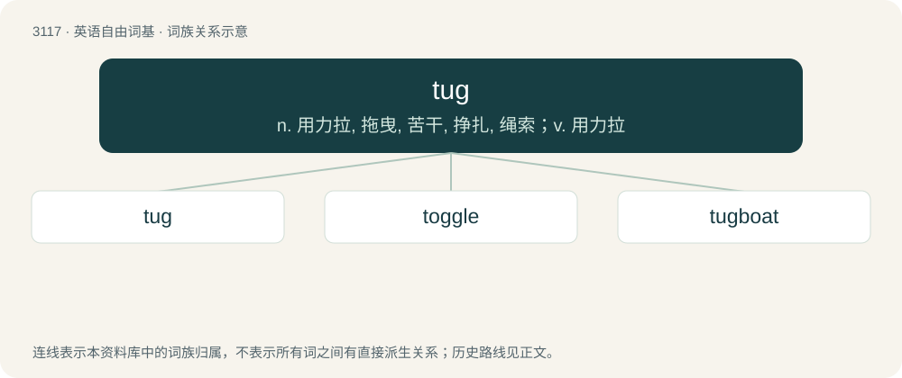

# 3215 · tug — n. 用力拉, 拖曳, 苦干, 挣扎, 绳索；v. 用力拉

[总目录](../00_总目录_按常用程度.md)

**类型**：英语自由词基　｜　**来源语言**：见词源记录

## 核心含义与来源

- 核心含义：n. 用力拉, 拖曳, 苦干, 挣扎, 绳索；v. 用力拉
- 英文含义：To pull or drag with great effort.
- 词形：tug

**多个词源／构词路径**：同一拼写可能有不同来源；以下按词性和含义分别列出。

**来源记录 1**（动词；To pull or drag with great effort.）

From Middle English tuggen, from Old English togian (“to tow”), from Proto-West Germanic \*togōn, from Proto-Germanic \*tugōną (“to draw, pull”), from Proto-Indo-European \*dewk- (“to draw, pull; to lead”). Cognates Cognate with German zögern (“to hesitate, pause”), Faroese and Icelandic toga (“to pull”), French touer (“to tow, tug a ship”); also Welsh dwyn (“to steal; to take; to bring to”), Latin dūcō (“to conduct, guide, lead; to take; to draw, pull; to consider, think; to prolong; to march; to forge”), Ancient Greek δαδύσσομαι (dadússomai, “to be distracted”), Albanian nduk (“to pluck out, pull out, tear”), Central Kurdish دۆشین (doşîn, “to milk”), Northern Kurdish dotin, doşîn, دۆشین (doşîn, “to milk”), Ossetian ду́цын (dúcyn, “to milk”), Pashto لوشل (lwašal, “to milk; to extort”), Persian دوشیدن (dōšīdan / dušidan), دوشتن (duštan), دوختن (dōxtan / duxtan, “to milk”). Related to tow.

**来源记录 2**（名词；A foundationer or colleger at Eton.）

Related to toga.

## 词族图

## 单词速览（常用到不常用）

| 单词 | 音标 | 释义 |
|---|---|---|
| [tug](#w-1) | 英 /ˈtʌɡ/ | n. 用力拉, 拖曳, 苦干, 挣扎, 绳索；v. 用力拉 |
| [toggle](#w-2) | 英 /ˈtɒɡ.əl/；美 /ˈtɑ.ɡəl/ | n. 绳针, 套索钉；vt. 拴牢；\[计\] 切换 |
| [tugboat](#w-3) | 英 /ˈtʌɡbəʊt/；美 /ˈtʌɡboʊt/ | n. 拖船；\[化\] 拖轮 |

## 逐词详解

### 1. tug

**词性**：动词　｜　**音标**：英 /ˈtʌɡ/

**中文释义**：n. 用力拉, 拖曳, 苦干, 挣扎, 绳索；v. 用力拉

**英文义项**：To pull or drag with great effort. / To pull hard repeatedly.

**词源与演化**：

From Middle English tuggen, from Old English togian (“to tow”), from Proto-West Germanic \*togōn, from Proto-Germanic \*tugōną (“to draw, pull”), from Proto-Indo-European \*dewk- (“to draw, pull; to lead”). Cognates Cognate with German zögern (“to hesitate, pause”), Faroese and Icelandic toga (“to pull”), French touer (“to tow, tug a ship”); also Welsh dwyn (“to steal; to take; to bring to”), Latin dūcō (“to conduct, guide, lead; to take; to draw, pull; to consider, think; to prolong; to march; to forge”), Ancient Greek δαδύσσομαι (dadússomai, “to be distracted”), Albanian nduk (“to pluck out, pull out, tear”), Central Kurdish دۆشین (doşîn, “to milk”), Northern Kurdish dotin, doşîn, دۆشین (doşîn, “to milk”), Ossetian ду́цын (dúcyn, “to milk”), Pashto لوشل (lwašal, “to milk; to extort”), Persian دوشیدن (dōšīdan / dušidan), دوشتن (duštan), دوختن (dōxtan / duxtan, “to milk”). Related to tow.

**例句**：

> How do you train a dog not to tug on its leash?

### 2. toggle

**词性**：动词　｜　**音标**：英 /ˈtɒɡ.əl/；美 /ˈtɑ.ɡəl/

**中文释义**：n. 绳针, 套索钉；vt. 拴牢；\[计\] 切换

**英文义项**：To alternate between two positions using a single switch or lever. / To switch between alternate states.

**构词拆分**：tug (“to pull”) + -le

**词源与演化**：

Of uncertain origin. Possible alteration of tug (“to pull”) + -le

**例句**：

> You can quickly toggle the case of selected text by pressing Alt+C.

该用例对应义项：To switch between alternate states.

### 3. tugboat

**词性**：名词　｜　**音标**：英 /ˈtʌɡbəʊt/；美 /ˈtʌɡboʊt/

**中文释义**：n. 拖船；\[化\] 拖轮

**英文义项**：A small, powerful boat used to push or pull barges or to help maneuver larger vessels. / A Social Security Disability Insurance payment; monthly tugboat

**构词拆分**：tug + boat

**词源与演化**：

From tug + boat. Sense 2 from monthly tugboat, a reference to the saying "our ship has come in," here referring to a small, "reliable" "tugboat" instead of a large windfall.

**例句**：

> The tugboat guided the ship into the Algiers port.
