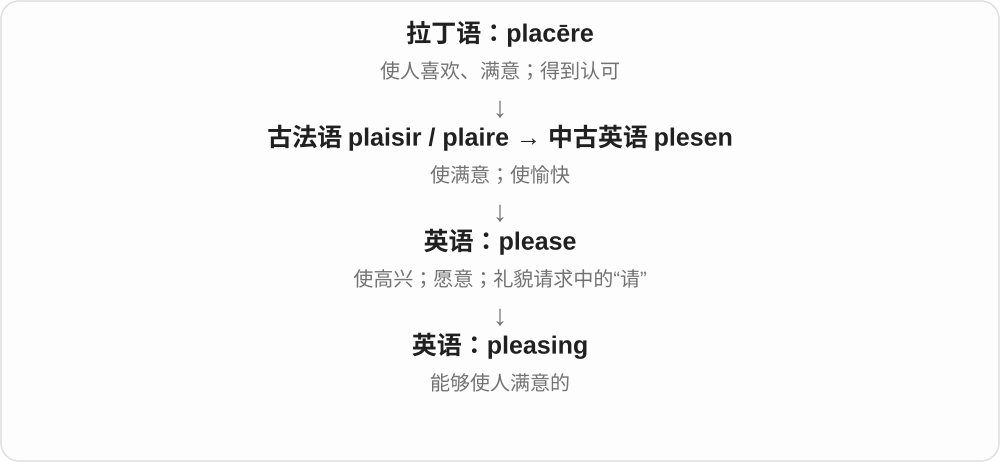

# 3216 · pleasing — 使人愉快、满意的性质，副词再表达这种感受

[逐词精讲目录](../00_逐词精讲目录.md) · [总目录](../00_总目录_按常用程度.md)

## 核心词根与来源

pleasing 看东西让人怎样感觉，pleased 则看人已经满意。副词 pleasingly 常把评价放到一个具体性质前。

**PLEASING：东西给人舒服、合意的感觉**

pleasing → pleasingly，先性质，再修饰简洁、顺滑等具体特征。

- **性质与方式评价**：pleasing · pleasingly

## 词形与演化规律

please 去 e + -ing → pleasing；+ -ly → pleasingly。

## 单词速览（按词族由简到繁）

同一基础词的相关扩展放在一起，先读基础形式，再读扩展；各组之间优先读常用的。具体词源关系见各词讲解。

| 单词 | 音标 | 核心意思 |
|---|---|---|
| [pleasing](#w-1) | 英 /ˈpliːzɪŋ/；美 /ˈpliːzɪŋ/ | 令人愉快的；令人满意的 |
| [pleasingly](#w-2) | /ˈpliːzɪŋli/ | 令人愉快、满意地；看着、感觉很舒服地 |

## 逐词讲解

### 1. pleasing — 令人愉快的；令人满意的

**音标**：英 /ˈpliːzɪŋ/；美 /ˈpliːzɪŋ/

**先抓住这个画面**

一个颜色、声音或结果进入眼耳或心里，给人一种“舒服、不错”的反应。

**怎么拆**

please + -ing，分词形容能带来愉快或满意的事物。

**怎么变成今天的意思**

常形容外观、声音、效果；a pleasing result 是令人满意的结果。比 nice 更书面一些。

**常见搭配与例句**

pleasing to the eye；a pleasing result；a pleasing design。

> The room has a pleasing balance of light and colour.

房间的光线和色彩搭配得很舒服。

> It was pleasing to see the team work so well together.

看到团队配合得这么好，令人高兴。

**别混淆**

pleasing 强调带来满意的效果；pleased 强调接收这个效果的人已经感到满意。

### 2. pleasingly — 令人愉快、满意地；看着、感觉很舒服地

**音标**：/ˈpliːzɪŋli/

**先抓住这个画面**

一个设计简单得让人舒服，叫 pleasingly simple。它不只是说简单，还补上“这种简单正合人意”的感受。

**怎么拆**

pleasing + -ly → pleasingly，中古英语已有相应副词形式。-ing 的性质再接方式副词尾，不能只看到 ing 就一律译正在。

**怎么变成今天的意思**

**please → pleasing 令人愉快、满意的**  
-ing 性质侧重给人的感受

↓

**pleasing + -ly → pleasingly**  
以让人感觉舒服、满意的方式

pleasingly simple 简洁得令人满意；pleasingly smooth 顺滑舒适；a pleasingly balanced design 令人舒服的均衡设计。

**常见搭配与例句**

pleasingly simple；pleasingly smooth。

> The instructions are pleasingly simple.

说明简洁明了，让人看着很舒服。

> The melody ends pleasingly on a quiet note.

旋律在一个安静的音符上结束，听着很舒服。

**别混淆**

pleasantly 与 pleasingly 有重叠，pleasingly 常突出某种特征令人满意；happily 更常看人的心情或幸运结果。

## 这一组要分清什么

pleasing 给人满意，pleased 自己满意；pleasingly 不只是一个人在开心地做动作。

## 串起来练习

The pleasing design is pleasingly simple.

这个设计令人舒服，简洁得恰到好处。
