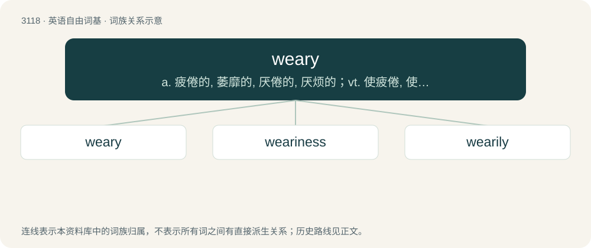

# 3217 · weary — a. 疲倦的, 萎靡的, 厌倦的, 厌烦的；vt. 使疲倦, 使厌烦；vi. 疲乏, 生厌, 不耐烦

[总目录](../00_总目录_按常用程度.md)

**类型**：英语自由词基　｜　**来源语言**：见词源记录

## 核心含义与来源

- 核心含义：a. 疲倦的, 萎靡的, 厌倦的, 厌烦的；vt. 使疲倦, 使厌烦；vi. 疲乏, 生厌, 不耐烦
- 英文含义：Having the strength exhausted by toil or exertion; tired; fatigued.
- 词形：weary

**来源记录 1**（形容词；Having the strength exhausted by toil or exertion; tired; fatigued.）

From Middle English wery, weri, from Old English wēriġ (“weary”), from Proto-West Germanic \*wōrīg, \*wōrag (“weary”). Cognate with Saterland Frisian wuurich (“weary, tired”), West Frisian wurch (“tired”), Dutch dialectal wurrig (“exhausted”), Old Saxon wōrig (“weary”), Old High German wōrag, wuarag (“drunken”), Latvian vārgs (“weak”), Lithuanian vergas (“slave”), Latvian vergs (“slave”).

## 词族图

## 单词速览（常用到不常用）

| 单词 | 音标 | 释义 |
|---|---|---|
| [weary](#w-1) | 英 /ˈwɪə̯ɹi/；美 /ˈwɪɚi/ | a. 疲倦的, 萎靡的, 厌倦的, 厌烦的；vt. 使疲倦, 使厌烦；vi. 疲乏, 生厌, 不耐烦 |
| [weariness](#w-2) | 英 /ˈwɪəɹinɪs/；美 /ˈwɪ(ə)ɹinɪs/ | n. 疲倦, 厌倦, 疲劳 |
| [wearily](#w-3) | 英 /ˈwɪəɹɪli/；美 /ˈwɪɹɪli/ | adv. 疲倦地, 厌倦地, 无聊地 |

## 逐词详解

### 1. weary

**词性**：形容词　｜　**音标**：英 /ˈwɪə̯ɹi/；美 /ˈwɪɚi/

**中文释义**：a. 疲倦的, 萎靡的, 厌倦的, 厌烦的；vt. 使疲倦, 使厌烦；vi. 疲乏, 生厌, 不耐烦

**英文义项**：Having the strength exhausted by toil or exertion; tired; fatigued. / Having one's patience, relish, or contentment exhausted; tired; sick.

**词源与演化**：

From Middle English wery, weri, from Old English wēriġ (“weary”), from Proto-West Germanic \*wōrīg, \*wōrag (“weary”). Cognate with Saterland Frisian wuurich (“weary, tired”), West Frisian wurch (“tired”), Dutch dialectal wurrig (“exhausted”), Old Saxon wōrig (“weary”), Old High German wōrag, wuarag (“drunken”), Latvian vārgs (“weak”), Lithuanian vergas (“slave”), Latvian vergs (“slave”).

**例句**：

> soldiers weary of marching, or of confinement; I grew weary of studying and left the library.

该用例对应义项：Having one's patience, relish, or contentment exhausted; tired; sick.

### 2. weariness

**词性**：名词　｜　**音标**：英 /ˈwɪəɹinɪs/；美 /ˈwɪ(ə)ɹinɪs/

**中文释义**：n. 疲倦, 厌倦, 疲劳

**英文义项**：Exhaustion, fatigue or tiredness. / A lack of interest or excitement.

**构词拆分**：weary + -ness

**词源与演化**：

From Middle English werynes, werinesse, from Old English wēriġnes (“weariness”), equivalent to weary + -ness.

**例句**：

> You can see a deep weariness in her face.

### 3. wearily

**词性**：副词　｜　**音标**：英 /ˈwɪəɹɪli/；美 /ˈwɪɹɪli/

**中文释义**：adv. 疲倦地, 厌倦地, 无聊地

**英文义项**：In a weary manner; feeling weary. / In a weary manner; causing weariness.

**构词拆分**：weary + -ly

**词源与演化**：

From Middle English werily, werelye, equivalent to weary + -ly.

**例句**：

> When school was dismissed and the children had gone Anne dropped wearily into her chair.
