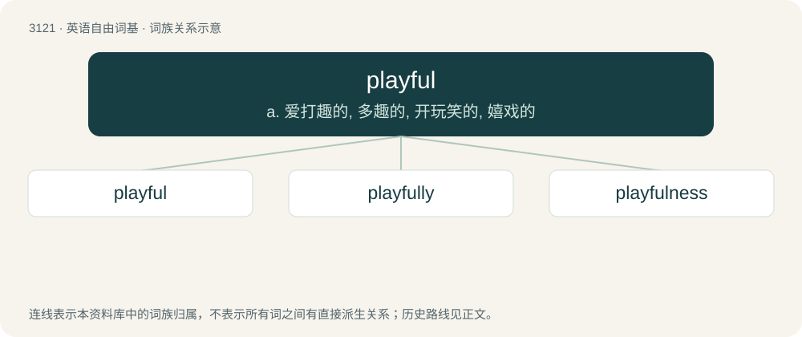

# 3220 · playful — a. 爱打趣的, 多趣的, 开玩笑的, 嬉戏的

[总目录](../00_总目录_按常用程度.md)

**类型**：英语自由词基　｜　**来源语言**：见词源记录

## 核心含义与来源

- 核心含义：a. 爱打趣的, 多趣的, 开玩笑的, 嬉戏的
- 英文含义：Enjoying play; sportive; prone to playing frequently, in the manner of a child or young pet (viz. puppy or kitten).
- 词形：playful

**来源记录 1**（形容词；Enjoying play; sportive; prone to playing frequently, in the manner of a child or young pet (viz. puppy or kitten).）

From Middle English pleiful, equivalent to play + -ful.

## 词族图

## 单词速览（常用到不常用）

| 单词 | 音标 | 释义 |
|---|---|---|
| [playful](#w-1) | /ˈpleɪfl̩/ | a. 爱打趣的, 多趣的, 开玩笑的, 嬉戏的 |
| [playfully](#w-2) |  | adv. 开玩笑地；好游玩地 |
| [playfulness](#w-3) |  | n. 活泼快乐, 戏谑; 童心 |

## 逐词详解

### 1. playful

**词性**：形容词　｜　**音标**：/ˈpleɪfl̩/

**中文释义**：a. 爱打趣的, 多趣的, 开玩笑的, 嬉戏的

**英文义项**：Enjoying play; sportive; prone to playing frequently, in the manner of a child or young pet (viz. puppy or kitten). / Funny; humorous; jesty; frolicsome; frisky.

**构词拆分**：play + -ful

**词源与演化**：

From Middle English pleiful, equivalent to play + -ful.

**例句**：

> A brainteaser is a playful puzzle posed as a test of intelligence.

该用例对应义项：Fun; recreational; unserious.

### 2. playfully

**词性**：副词

**中文释义**：adv. 开玩笑地；好游玩地

**英文义项**：In a playful manner.

**构词拆分**：playful + -ly

**词源与演化**：

From playful + -ly.

**例句**：

> She loosened the half-hoop of diamonds on her left hand third finger and held it out to him playfully.

该用例对应义项：in a playful manner

### 3. playfulness

**词性**：名词

**中文释义**：n. 活泼快乐, 戏谑; 童心

**英文义项**：The quality of being playful.

**构词拆分**：playful + -ness

**词源与演化**：

From playful + -ness.

**例句**：

> Such playfulness is characteristic of Mr Baker.
