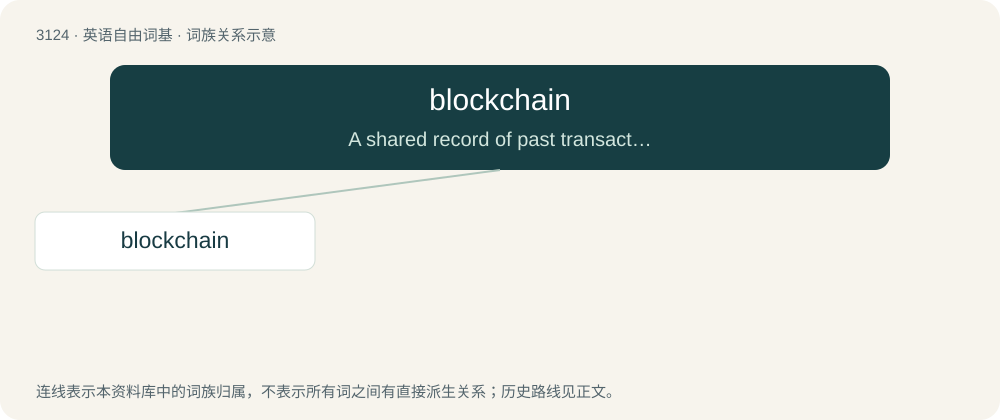

# 3225 · blockchain — A shared record of past transactions in a distributed network, typically used for cryptocurrency.

[总目录](../00_总目录_按常用程度.md)

**类型**：英语自由词基　｜　**来源语言**：见词源记录

## 核心含义与来源

- 核心含义：A shared record of past transactions in a distributed network, typically used for cryptocurrency.
- 英文含义：A shared record of past transactions in a distributed network, typically used for cryptocurrency.
- 词形：blockchain

**来源记录 1**（名词；A shared record of past transactions in a distributed network, typically used for cryptocurrency.）

From block + chain, from earlier “block chain”. In the 2008 Bitcoin paper block and chain are used separately; the concept is referred to as “chain of hash-based proof-of-work” or “chain of digital signatures”.

## 词族图

## 单词速览（常用到不常用）

| 单词 | 音标 | 释义 |
|---|---|---|
| [blockchain](#w-1) |  | 【英文】A shared record of past transactions in a distributed network, typically used for cryptocurrency. |

## 逐词详解

### 1. blockchain

**词性**：名词

**英文义项**：A shared record of past transactions in a distributed network, typically used for cryptocurrency.

**构词拆分**：block + chain

**词源与演化**：

From block + chain, from earlier “block chain”. In the 2008 Bitcoin paper block and chain are used separately; the concept is referred to as “chain of hash-based proof-of-work” or “chain of digital signatures”.

**例句**：

> Tom created an AI that uses blockchain technology to attract venture capital.
