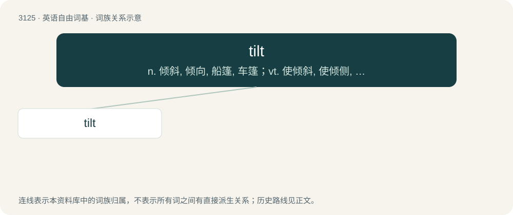

# 3227 · tilt — n. 倾斜, 倾向, 船篷, 车篷；vt. 使倾斜, 使倾侧, 用帆布篷遮盖；vi. 倾斜, 翘起, 冲, 评击

[总目录](../00_总目录_按常用程度.md)

**类型**：英语自由词基　｜　**来源语言**：见词源记录

## 核心含义与来源

- 核心含义：n. 倾斜, 倾向, 船篷, 车篷；vt. 使倾斜, 使倾侧, 用帆布篷遮盖；vi. 倾斜, 翘起, 冲, 评击
- 英文含义：To slope or incline (something); to slant.
- 词形：tilt

**多个词源／构词路径**：同一拼写可能有不同来源；以下按词性和含义分别列出。

**来源记录 1**（动词；To slope or incline (something); to slant.）

From Middle English tilte, from Old English \*tyltan, \*tieltan (“to be unsteady”), related to the adjective tealt (“unsteady”), from Proto-West Germanic \*talt, ultimately from Proto-Indo-European \*del-, \*dul- (“to shake, hesitate”), see also Dutch touteren (“to tremble”), North Frisian talt, tolt (“unstable, shaky”). Cognate with Icelandic tölt (“an ambling pace”). The nominal sense of "a joust" appears around 1510, presumably derived from the barrier which separated the combatants, which suggests connection with tilt "covering". The modern transitive meaning is from 1590; the intransitive use appears 1620. The sense of gaming frustration is said to originate with pinball.

**来源记录 2**（名词；A canvas covering for carts, boats, etc.）

From Middle English telte, tield, teld, from Old English teld (“tent”), from Proto-West Germanic \*teld, from Proto-Germanic \*teldą (“tent”). Perhaps influenced by Middle Low German telt, or Danish telt. Cognates include German Zelt (“tent”), Old Norse tjald (“tent”) (whence also archaic Danish tjæld (“tent”)). More at teld.

## 词族图

## 单词速览（常用到不常用）

| 单词 | 音标 | 释义 |
|---|---|---|
| [tilt](#w-1) | 英 /tɪlt/ | n. 倾斜, 倾向, 船篷, 车篷；vt. 使倾斜, 使倾侧, 用帆布篷遮盖；vi. 倾斜, 翘起, 冲, 评击 |

## 逐词详解

### 1. tilt

**词性**：动词　｜　**音标**：英 /tɪlt/

**中文释义**：n. 倾斜, 倾向, 船篷, 车篷；vt. 使倾斜, 使倾侧, 用帆布篷遮盖；vi. 倾斜, 翘起, 冲, 评击

**英文义项**：To slope or incline (something); to slant. / To be at an angle.

**词源与演化**：

From Middle English tilte, from Old English \*tyltan, \*tieltan (“to be unsteady”), related to the adjective tealt (“unsteady”), from Proto-West Germanic \*talt, ultimately from Proto-Indo-European \*del-, \*dul- (“to shake, hesitate”), see also Dutch touteren (“to tremble”), North Frisian talt, tolt (“unstable, shaky”). Cognate with Icelandic tölt (“an ambling pace”). The nominal sense of "a joust" appears around 1510, presumably derived from the barrier which separated the combatants, which suggests connection with tilt "covering". The modern transitive meaning is from 1590; the intransitive use appears 1620. The sense of gaming frustration is said to originate with pinball.

**例句**：

> Tilt the barrel to pour out its contents.

该用例对应义项：To slope or incline (something); to slant.
