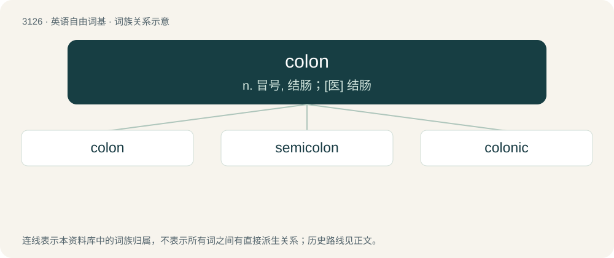

# 3228 · colon — n. 冒号, 结肠；\[医\] 结肠

[总目录](../00_总目录_按常用程度.md)

**类型**：英语自由词基　｜　**来源语言**：见词源记录

## 核心含义与来源

- 核心含义：n. 冒号, 结肠；\[医\] 结肠
- 英文含义：The punctuation mark ⟨:⟩.
- 词形：colon

**多个词源／构词路径**：同一拼写可能有不同来源；以下按词性和含义分别列出。

**来源记录 1**（名词；The punctuation mark ⟨:⟩.）

From Latin cōlon (“a member of a verse of poem”), from Ancient Greek κῶλον (kôlon, “a member, limb, clause, part of a verse”).

**来源记录 2**（名词；Part of the large intestine; the final segment of the digestive system, after (distal to) the ileum and before (proximal to) the rectum. (Because the colon is the largest part of the large intestine (constituting most of it), it is often treated as synonymous therewith in broad or casual usage.)）

From Latin cŏlon (“large intestine”), from Ancient Greek κόλον (kólon, “the large intestine, also food, meat, fodder”).

**来源记录 3**（名词；A European colonial settler, especially in a French colony.）

From French colon.

## 词族图

## 单词速览（常用到不常用）

| 单词 | 音标 | 释义 |
|---|---|---|
| [colon](#w-1) | 英 /ˈkəʊ.lən/；美 /ˈkoʊ.lən/ | n. 冒号, 结肠；\[医\] 结肠 |
| [semicolon](#w-2) | 英 /ˌsɛmiˈkəʊlən/；美 /ˈsɛmikoʊlən/ | n. 分号；\[计\] 分号 |
| [colonic](#w-3) | 英 /kəˈlɒn.ɪk/；美 /kəˈlɔn.ɪk/ | a. 结肠的；\[医\] 结肠的 |

## 逐词详解

### 1. colon

**词性**：名词　｜　**音标**：英 /ˈkəʊ.lən/；美 /ˈkoʊ.lən/

**中文释义**：n. 冒号, 结肠；\[医\] 结肠

**英文义项**：The punctuation mark ⟨:⟩. / The triangular colon (especially in context of not being able to type the actual triangular colon).

**词源与演化**：

From Latin cōlon (“a member of a verse of poem”), from Ancient Greek κῶλον (kôlon, “a member, limb, clause, part of a verse”).

**例句**：

> Tom was diagnosed with colon cancer in October of 2013.

### 2. semicolon

**词性**：名词　｜　**音标**：英 /ˌsɛmiˈkəʊlən/；美 /ˈsɛmikoʊlən/

**中文释义**：n. 分号；\[计\] 分号

**英文义项**：The punctuation mark ;.

**构词拆分**：semi- + colon

**词源与演化**：

From semi- + colon.

**例句**：

> In French, a space must always be left either side of a semicolon.

### 3. colonic

**词性**：形容词　｜　**音标**：英 /kəˈlɒn.ɪk/；美 /kəˈlɔn.ɪk/

**中文释义**：a. 结肠的；\[医\] 结肠的

**英文义项**：Of, relating to, affecting, or within the colon.

**构词拆分**：colon + -ic

**词源与演化**：

From colon + -ic.

**例句**：

> Does colonic irrigation have any health benefits and is it available on the NHS?
